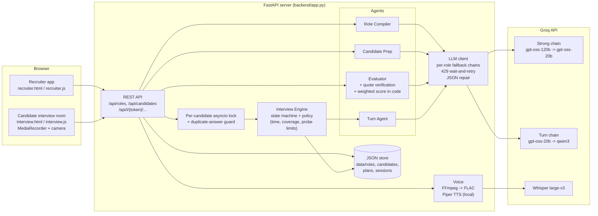
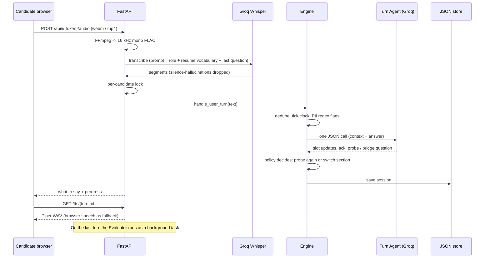
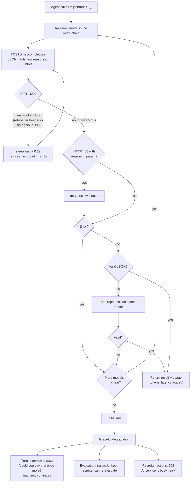

# Tryout - Architecture

## System overview

## Where the LLM is called

| Agent          | Model chain | How often                                    | Input -> output                                                 |
| -------------- | ----------- | -------------------------------------------- | --------------------------------------------------------------- |
| Role Compiler  | strong      | once per role (+ each plain-language refine) | Hiring document -> sections, slots, criteria                    |
| Candidate Prep | strong      | once per candidate                           | Resume + JD -> highlights, claims, openers, fit, STT vocabulary |
| Turn Agent     | turn        | once per candidate answer                    | Context + answer -> slot updates, ack, probe / bridge question  |
| Evaluator      | strong      | once per interview (background task)         | Transcript + rubric -> ratings, quotes, feedback                |
| Whisper        | STT         | once per spoken answer                       | Audio + vocabulary hint -> text                                 |

Everything else is plain code: section timing, when to move on, which question is spoken, quote verification,
the weighted score, and the resume-fit percentage.

## One interview turn

## Groq rate-limit handling

Whisper has its own retry: up to 3 attempts with 2s and 4s back-off on 429.
