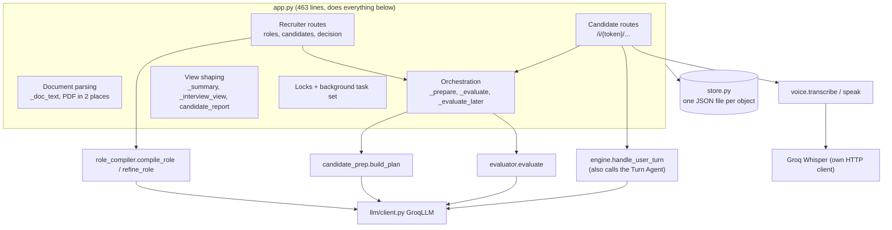
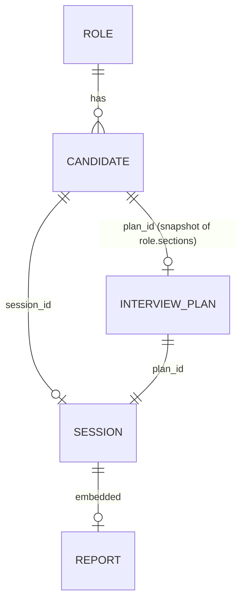
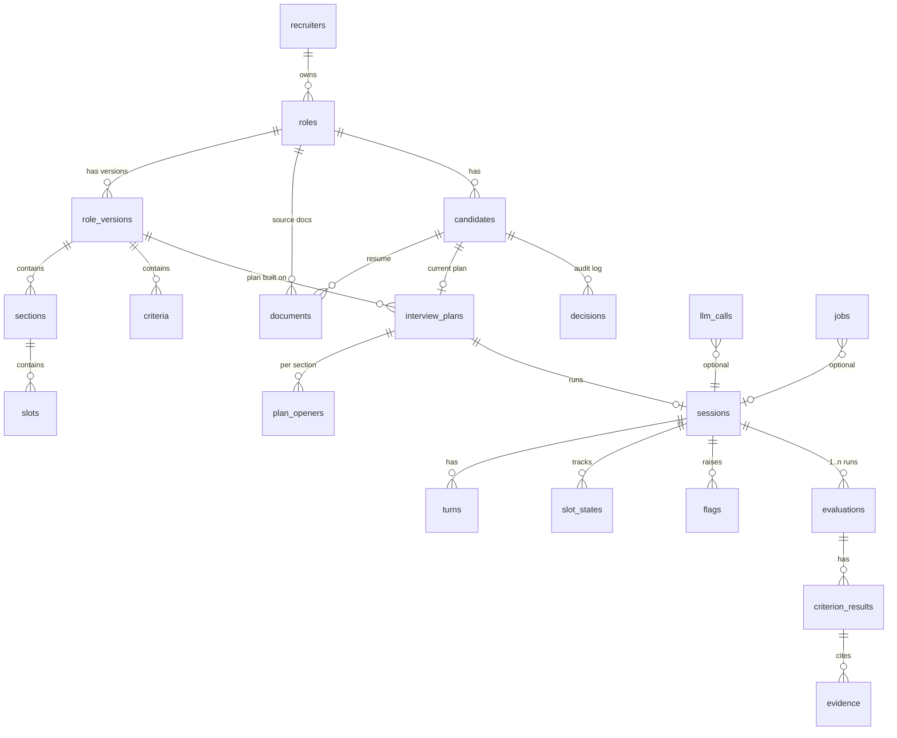

# Tryout - Backend Audit and Redesign Plan

Status: audit of `main` @ `78704d9` (2026-10-22). Scope: everything under `backend/`, plus `tests/` and
`scripts/simulate.py` where they show how the backend is used. Frontend is out of scope for this pass.

Code navigation map (layers, routes, flows, where to find things): [system-design.md](system-design.md).

This document answers three questions:

1. **What is actually there?** Every agent, what it reads, what it returns, which code "tools" act on its output,
   and where it lives (section 1-3).
2. **What is wrong with it?** Bugs, risks and structural problems, ranked (section 4).
3. **What should it become?** A target layout, and feature-by-feature goals with a clear "done when" for each
   (sections 5-7).

---

## 1. The mental model (read this first)

The main source of confusion: **the "agents" in Tryout are not tool-using agents.** None of them call tools, loop,
or decide what to do next. Each one is a **single LLM call that takes a prompt and returns one JSON object.**
Plain Python code then validates that JSON and does all the real decision making.

```
          input data ──► prompt template (.md) ──► one LLM call (JSON mode) ──► dict
                                                                                │
                      deterministic code ("the tools") ◄───────────────────────┘
                      validates, clamps, verifies, scores, decides
                                    │
                                    ▼
                          Pydantic model saved to disk
```

So when we say "an agent and its tools", in this codebase that really means:

| Concept       | What it is in Tryout                                                                 |
| ------------- | ------------------------------------------------------------------------------------ |
| Agent         | A prompt file in `backend/prompts/` + one `get_llm().json(...)` call                 |
| Model tier    | `role="strong" / "turn" / "aux"` picks a fallback chain from `config.MODELS`         |
| Output schema | Written twice: as an example in the prompt, and as hand-written parsing code         |
| "Tools"       | Python functions that run **after** the call: `apply_compiled`, `score_fit`, `quote_found`, `build_report`, `policy.*` |
| Orchestrator  | Split between `app.py` (when agents run) and `engine/engine.py` (the interview loop) |

The principle "the LLM proposes, the code decides" is good and worth keeping. The problem is that the code does
not make this structure visible: agents live in three different places, schemas are implicit, and orchestration
is mixed into HTTP handlers.

---

## 2. Inventory: every LLM call in the system

There are **five agents plus Whisper**, not the four the README lists.

| # | Agent | Lives in | Prompt | Model tier | Trigger | Output (keys) | Code that acts on output |
|---|-------|----------|--------|-----------|---------|---------------|--------------------------|
| 1 | Role Compiler | [agents/role_compiler.py](../backend/agents/role_compiler.py#L14-L30) | `role_compiler.md` | strong, 7000 tok | `POST /api/roles`, `POST /api/roles/from-document` | `title, company, time_budget_sec, jd_summary, interviewer_notes, sections[], criteria[]` | `apply_compiled`: snake_case ids, dedupe, clamp weight 0.5-3, priority 1-3, scale section time to 85% |
| 2 | Role Refine (undocumented) | [agents/role_compiler.py](../backend/agents/role_compiler.py#L101-L108) | `role_refine.md` | strong, 6000 tok | `POST /api/roles/{id}/refine` | `sections[], criteria[]` | same `apply_compiled` |
| 3 | Candidate Prep | [agents/candidate_prep.py](../backend/agents/candidate_prep.py#L30-L58) | `candidate_prep.md` | strong, 3000 tok | add candidate with resume, candidate uploads resume, or interview start | `resume_highlights, claims_to_verify, openers{}, fit{items[]}, vocabulary[]` | `score_fit` (arithmetic fit %), opener must end in `?`, caps list sizes |
| 4 | Turn Agent | [engine/engine.py](../backend/engine/engine.py#L117-L164) (not in `agents/`) | `turn_agent.md` | turn (fast), 1500 tok | every candidate answer | `slot_updates[], ack, probe_question, gap, bridge_question, user_wants_skip, user_wants_stop, injection_suspected` | `_apply_updates`, `_fresh_ack`, `_next_question`, `policy.must_move_on / next_target / coverage` |
| 5 | Evaluator | [agents/evaluator.py](../backend/agents/evaluator.py#L27-L40) | `evaluator.md` | strong, 6000 tok | interview ends (background task) or `POST .../reevaluate` | `criteria[{rating, score, rationale, evidence[]}], summary, strengths, concerns, resume_flags, recommendation, candidate_feedback` | `build_report`: `quote_found` per quote, weighted score over verified criteria only |
| 6 | Whisper STT | [voice.py](../backend/voice.py#L48-L79) | prompt = vocab + hint | `STT_MODEL` | every voice answer | text segments | silence filter in `voice.py`, noise-word filter in [app.py](../backend/app.py#L398-L416) |
| - | Sim candidate (dev only) | [scripts/simulate.py](../scripts/simulate.py#L39-L45) | inline | aux | `./run.sh sim` | `reply` | none. `aux` is used only here. |

Non-LLM component that behaves like an agent:

| Component | Lives in | Job |
|-----------|----------|-----|
| Interview Engine | [engine/engine.py](../backend/engine/engine.py), [engine/policy.py](../backend/engine/policy.py), [engine/context.py](../backend/engine/context.py) | State machine, time and probe limits, section switching, builds the Turn Agent's STATE block, PII regex |

---

## 3. Current architecture

### 3.1 Request flow



### 3.2 Data model and its two state machines



There are **two overlapping status fields** that can drift apart:

```
Candidate.status : invited ─► in_progress ─► completed ─► advanced | hold | rejected
Session.state    : READY (never used) ─► INTERVIEWING ─► WRAPUP ─► EVALUATING ─► DONE
```

`Candidate.status` mixes *interview progress* with the *hiring decision*. `Session.state` has no "failed" value,
so a failed evaluation looks the same as a finished one with no report.

### 3.3 What each module owns today (and what it should not)

| Module | Owns | Also does (should move) |
|--------|------|-------------------------|
| `app.py` | routes | document parsing, orchestration, background jobs, locking, view building, STT noise filtering |
| `engine/engine.py` | state machine | calls the Turn Agent, renders its prompt, text-similarity heuristics, PII flagging |
| `agents/role_compiler.py` | role compile | also hosts a second agent (refine) and the output validator used by both |
| `voice.py` | STT + TTS | its own Groq client and retry logic, separate from `llm/client.py` |
| `store.py` | persistence | fine, but every list is a full directory scan |

---

## 4. Audit findings

Severity: **P0** breaks real use or leaks data. **P1** wrong behaviour users will hit. **P2** quality, cost, or
maintainability.

### P0 - must fix before anyone outside you uses it

| ID | Finding | Where | What happens | Fix |
|----|---------|-------|--------------|-----|
| A1 | **No recruiter auth.** Every `/api/roles` and `/api/candidates` route is public. | [app.py](../backend/app.py#L108-L296) | With `./run.sh share`, anyone with the tunnel URL can read every resume, transcript and report, and delete candidates. | Recruiter login (even a single shared password + session cookie for v1). Candidate routes stay token-only. |
| A2 | **Interviews are pinned to a stale brief.** The plan copies `role.sections` when the candidate is added, but the evaluator reads the *current* `role.criteria`. | [candidate_prep.py:31-33](../backend/agents/candidate_prep.py#L31-L33), [evaluator.py:34](../backend/agents/evaluator.py#L34) | Recruiter adds candidates, then refines the role: those candidates are interviewed on the old sections but scored on new criteria that no section collected evidence for. Breaks "same brief and rubric for every candidate". | Version the role. Plan stores `role_version` and a snapshot of criteria; evaluator scores against the plan's criteria. Warn the recruiter when editing a role that has invited candidates. |
| A3 | **Stuck sessions after restart.** Evaluation runs as an in-memory `asyncio` task. | [app.py:301-322](../backend/app.py#L301-L322) | Server restarts mid-evaluation: session stays `EVALUATING` forever, report never arrives. A candidate who closes the tab stays `INTERVIEWING` forever, no report. | On startup, re-queue sessions in `EVALUATING`. Add a sweeper that ends interviews idle for more than N minutes and evaluates them. |
| A4 | **Background evaluation races with reset/delete.** | [app.py:263-288](../backend/app.py#L263-L288) vs [app.py:301-316](../backend/app.py#L301-L316) | Reset or delete during evaluation: the session file is deleted, then `_evaluate` saves it again (orphan), or `_get(Candidate)` raises inside the task. | Evaluation takes the candidate lock for its final write, and checks the session still belongs to the candidate before saving. |

### P1 - wrong behaviour

| ID | Finding | Where | What happens | Fix |
|----|---------|-------|--------------|-----|
| B1 | **Retry after an LLM failure is swallowed as a duplicate.** | [engine.py:121-125](../backend/engine/engine.py#L121-L125), [engine.py:144-147](../backend/engine/engine.py#L144-L147) | Turn Agent fails, interviewer says "could you say that once more?". Candidate repeats the same words within 20 s: the duplicate guard replays the fallback line and never calls the LLM. The candidate loops. | Skip the duplicate guard when the last agent turn was the fallback; better, mark fallback turns (`Turn.kind="fallback"`) and drop the unanswered user turn from slot evidence. |
| B2 | **Evaluation failure is silent.** | [app.py:308-312](../backend/app.py#L308-L312), [app.py:291-296](../backend/app.py#L291-L296) | State becomes `DONE` with `report=None`; `reevaluate` returns 200 with no report and no reason. Recruiter cannot tell "failed" from "nothing said". | Add `Session.state = "EVAL_FAILED"` plus `eval_error`; `reevaluate` returns 503 on failure. |
| B3 | **Candidate Prep failure is silent.** | [candidate_prep.py:41-46](../backend/agents/candidate_prep.py#L41-L46) | Rate limit during prep: candidate gets generic openers and `fit=None`; recruiter sees no error and no way to retry. | Store `plan.prep_status = ok / failed`; show it; add `POST /api/candidates/{id}/prepare`. |
| B4 | **Recommendation ignores verification.** Code drops unverified criteria from the score but keeps the LLM's recommendation as is. | [evaluator.py:63-67](../backend/agents/evaluator.py#L63-L67) | Evaluator says "advance" based on a fabricated quote; report shows advance with a lower, verified-only score. | Derive the suggestion in code from verified ratings and weights, or downgrade to `hold` when any weight >= 2 criterion is unverified. |
| B5 | **Score not tied to rating.** | [evaluator.py:56-57](../backend/agents/evaluator.py#L56-L57) | `below_bar` with `score: 5` is accepted. | Clamp score into the band of its rating (below 1-2.4, meets 2.5-3.9, above 4-5). |
| B6 | **Quotes are only checked against the cited turn.** | [evaluator.py:53-54](../backend/agents/evaluator.py#L53-L54) | A real quote with a wrong `turn_id` is thrown away, criterion marked unverified. | If not found in the cited turn, search all user turns and correct the id. |
| B7 | **DOCX resumes become garbage.** Resume upload handles only PDF; anything else is decoded as text. | [app.py:346-354](../backend/app.py#L346-L354) | A `.docx` resume is zip bytes decoded to junk, passes the 100-char check, and is sent to the LLM. | One shared `documents.extract_text()` used by both role and resume upload. |
| B8 | **`TIME_BUDGET_SEC` in `.env` does nothing.** | [config.py:15](../backend/config.py#L15), [app.py:105](../backend/app.py#L105), [models.py:55](../backend/models.py#L55) | README says it sets the default length; actual default is hard-coded 900 in two places. | Use `config.TIME_BUDGET_SEC` as the single default. |
| B9 | **Manual role edits skip validation.** | [app.py:184-192](../backend/app.py#L184-L192) | `PUT /api/roles` accepts duplicate ids, sections over the time budget, criteria with weight 50. Changing `time_budget_sec` does not rescale sections. | Run the same validator as `apply_compiled` on manual edits. |
| B10 | **Decision allowed before interview.** | [app.py:245-252](../backend/app.py#L245-L252) | Recruiter can "advance" an invited candidate who never interviewed; `completed` status is then lost. | Split `interview_status` and `decision` into two fields (see C1). |
| B11 | **LLM can downgrade filled slots.** | [engine.py:94](../backend/engine/engine.py#L94) | A later vague answer can flip `filled` back to `vague`, and the engine re-probes something already answered. | Slot status only moves forward (`missing -> vague -> filled`), except to `conflict`. |
| B12 | **Per-slot probe limit only counts when the LLM fills `gap`.** | [engine.py:186-190](../backend/engine/engine.py#L186-L190) | If `gap` is omitted, `probes_left` never drops for any slot. | Fall back to the first unresolved required slot when `gap` is missing. |
| B13 | **The recruiter's original document is overwritten.** `role.jd` is replaced by the LLM's `jd_summary`, and `role.notes` by `interviewer_notes`. | [role_compiler.py:28-29](../backend/agents/role_compiler.py#L28-L29) | The source document is gone after the first compile; refine and re-compile work from a lossy summary, and there is no way to show what the brief was built from. | Store the uploaded document as its own record; keep the summary as a separate field. See section 8. |

### P2 - quality, cost, maintainability

| ID | Finding | Where | Fix |
|----|---------|-------|-----|
| C1 | `Candidate.status` mixes interview lifecycle and hiring decision; `Session.state="READY"` is never used. | [models.py:61](../backend/models.py#L61), [models.py:187](../backend/models.py#L187) | `Candidate.decision: advance/hold/reject/None`; interview status derived from Session. |
| C2 | Output schemas exist only as prompt examples and hand parsing. | all agents | One Pydantic output model per agent; prompt example generated from it; parsing is `Model.model_validate` + a small repair step. |
| C3 | Token usage dropped for Role Compiler, Refine and Prep (`data, _ = ...`). | [role_compiler.py:22](../backend/agents/role_compiler.py#L22), [role_compiler.py:106](../backend/agents/role_compiler.py#L106), [candidate_prep.py:42](../backend/agents/candidate_prep.py#L42) | Record usage on the Role / Plan too, so cost per role and per candidate is visible. |
| C4 | Reports do not record which model and prompt produced them. | [models.py:174-184](../backend/models.py#L174-L184) | `Report.model`, `Report.prompt_version`, `Report.role_version`. Needed for audits and fairness claims. |
| C5 | One 30 s HTTP timeout for every call. Strong calls with 6000-7000 output tokens can time out and double the latency by falling back. | [llm/client.py:73](../backend/llm/client.py#L73) | Timeout per agent (turn 15 s, strong 90 s). |
| C6 | Prompt rendering is sequential `str.replace`. A JD containing `{{resume}}` gets the resume pasted into it. | [prompts.py:21-23](../backend/prompts.py#L21-L23) | Single-pass regex substitution. Also escape closing tags (`</candidate_turn>`) in user data. |
| C7 | `_by_token` loads every candidate file on every request, including each audio and TTS call; `get_role` does N+1 file reads. | [app.py:66-70](../backend/app.py#L66-L70), [store.py:47-50](../backend/store.py#L47-L50) | Token index file now; SQLite when moving off JSON (see F8). |
| C8 | No upload size limit; `ffmpeg` has no timeout. | [app.py:401-411](../backend/app.py#L401-L411), [voice.py:36-45](../backend/voice.py#L36-L45) | Cap audio at ~10 MB / 3 min, documents at 5 MB; `asyncio.wait_for` on ffmpeg. |
| C9 | Whisper has its own client and retry, duplicating `llm/client.py`. New `httpx.AsyncClient` per answer. | [voice.py:55-79](../backend/voice.py#L55-L79) | Share one Groq transport and retry policy. |
| C10 | Probe limits and wrap-up reserve are module constants. | [policy.py:7-9](../backend/engine/policy.py#L7-L9) | Move to an `InterviewPolicy` model on the role (defaults unchanged). |
| C11 | Candidate view exposes per-section `coverage`. | [app.py:80-86](../backend/app.py#L80-L86) | Show only section names and progress, not evidence coverage. |
| C12 | Old plan file orphaned when a resume is re-uploaded; `start` saves session and candidate non-atomically. | [app.py:213-218](../backend/app.py#L213-L218), [app.py:374-375](../backend/app.py#L374-L375) | Delete superseded plan; save candidate last so a crash leaves no dangling pointer. |
| C13 | `@app.on_event("startup")` is deprecated. | [app.py:45](../backend/app.py#L45) | FastAPI `lifespan`. Also where A3's recovery goes. |
| C14 | Tests: 2 tests, both happy path. No test for LLM failure, reset during eval, role edit after invite, auth. | [tests/test_flow.py](../tests/test_flow.py) | One test per P0/P1 finding as it is fixed. |

---

## 5. Target design

### 5.1 Layout

Same stack (FastAPI, Pydantic, Groq). The change is **where things live**, so an agent, its schema, its prompt and
its code tools sit together, and HTTP handlers become thin.

```
backend/
  app.py                    create app, lifespan (startup recovery), mount routers. ~40 lines.
  config.py
  api/                      HTTP only: parse request, call a service, shape response
    recruiter.py            /api/roles, /api/candidates   (behind auth)
    candidate.py            /api/i/{token}/...
    auth.py
    views.py                _summary, _interview_view, report view
  services/                 use cases; the only place that orchestrates agents + store
    roles.py                create, compile, refine, edit (+ validation), versioning
    candidates.py           add, upload resume, prepare, reset, delete, decide
    interviews.py           start, turn, audio turn, end
    evaluation.py           run, re-run, recover on startup
    jobs.py                 background job runner (persisted job state, retries)
  agents/                   one folder per agent; nothing here touches HTTP or the store
    base.py                 AgentSpec + run_agent()
    role_compiler/          spec.py (schemas + postprocess), prompt.md
    role_refine/
    candidate_prep/
    turn_agent/             moved out of engine/
    evaluator/
  engine/                   pure interview logic, no LLM, no I/O
    state_machine.py        transitions, tick, advance
    policy.py               coverage, limits, scheduling
    context.py              STATE block builder
    heuristics.py           _similar, _fresh_ack
  safety/
    pii.py                  regex flags (from policy.py)
    injection.py            data-tag escaping, injection flag
  integrations/
    groq.py                 shared transport, retry, rate-limit handling
    llm.py                  model chains, JSON mode, repair (today's GroqLLM, FakeLLM)
    stt.py, tts.py          Whisper, Piper
    documents.py            PDF / DOCX / text extraction (one place)
  db.py                     SQLAlchemy engine + async session (services query through it directly)
  tables.py                 table definitions from section 8.4
  models/                   domain models split by area
    role.py, candidate.py, session.py, report.py
```

### 5.2 The agent contract

Every agent is declared the same way. This is what makes "agent, tools, working" readable at a glance.

```python
# agents/base.py
class AgentSpec(BaseModel, Generic[In, Out]):
    name: str                      # "evaluator"
    tier: Literal["strong", "turn", "aux"]
    prompt: str                    # file next to spec.py
    prompt_version: str            # bump when the prompt changes
    input_model: type[In]          # what the agent is given
    output_model: type[Out]        # what the LLM must return (Pydantic, validated)
    max_tokens: int
    temperature: float
    timeout_sec: float
    postprocess: Callable[[In, Out], Result]   # the code "tools": verify, clamp, score
    on_failure: Literal["raise", "fallback"]
    fallback: Callable[[In], Result] | None = None

async def run_agent(spec, inp) -> AgentRun[Result]:
    # render -> llm.json -> output_model.model_validate (one repair) -> postprocess
    # returns result + Usage(model, prompt_version, tokens, latency) so callers always get cost and provenance
```

Each agent folder then reads top to bottom as: **inputs, outputs, tools, failure behaviour**.

| Agent | Input model | Output model | Code tools (postprocess) | On failure |
|-------|-------------|--------------|---------------------------|------------|
| Role Compiler | `RoleDraftIn(title, document, notes, time_budget_sec, fixed_length)` | `CompiledRole` | `validate_brief` (ids, caps, time scaling, coverage check: every criterion maps to a slot) | raise -> 503 to recruiter |
| Role Refine | `RefineIn(current_brief, instruction)` | `CompiledRole` (sections + criteria) | `validate_brief`, `diff_brief` (show what changed) | raise |
| Candidate Prep | `PrepIn(role_version, sections, jd, resume)` | `PrepOut` | `score_fit`, `validate_openers`, `build_stt_hint` | fallback: generic plan, `prep_status=failed` |
| Turn Agent | `TurnIn(state_block, latest_turn, persona)` | `TurnOut` | `apply_slot_updates` (monotonic), `choose_next_question` (policy), `dedupe_question`, `fresh_ack` | fallback: re-ask line, turn marked `fallback` |
| Evaluator | `EvalIn(criteria_snapshot, transcript, slots, resume_claims)` | `EvalOut` | `verify_quotes` (all turns), `clamp_scores`, `weighted_score`, `derive_recommendation` | raise -> `EVAL_FAILED`, retry job |

### 5.3 State machines (one owner each)

```
Session.state:  INTERVIEWING ─► WRAPUP ─► ENDED ─► EVALUATING ─► DONE
                     │              │                    └──► EVAL_FAILED ─► (retry) ─► EVALUATING
                     └── idle > N min / candidate ends ──► ENDED

Candidate:      interview status is read from Session (not stored twice)
                decision: None | advance | hold | reject   (only settable when Session is DONE)
                feedback_released: bool                    (only when a report exists)
```

### 5.4 Background jobs

`services/jobs.py` keeps a small persisted job record (`job_id, kind, target_id, status, attempts, error`). On
startup the lifespan hook re-queues anything `queued` or `running`. Evaluation, prep retries and the idle-session
sweeper all go through it. This replaces the in-memory `_tasks` set and fixes A3 and A4.

---

## 6. Feature-by-feature goals

Each feature has a goal, the gap today, and a **done when** list that can be checked by a test or a manual step.

### F1. Role design (Role Compiler + Refine + manual edit)

**Goal:** A recruiter gets a brief they trust, and every candidate of a role is judged on exactly the same version.

Gaps: A2, B8, B9, C3, C4.

Done when:
- [ ] Role has `version`; every compile, refine or manual edit increments it and keeps the previous version.
- [ ] Manual edits run the same validator as compiled ones (unique ids, time sum <= 85%, weight 0.5-3).
- [ ] Validator reports any criterion that no slot collects evidence for, and the API returns it as a warning.
- [ ] Refine returns a diff (sections and criteria added / removed / changed) alongside the new brief.
- [ ] Editing a role with invited candidates asks whether to move them to the new version.
- [ ] `TIME_BUDGET_SEC` from `.env` is the default length.
- [ ] Token usage is recorded per compile / refine.

### F2. Candidate intake and prep (Candidate Prep)

**Goal:** Every candidate has a resume-aware plan, and the recruiter knows when prep did not work.

Gaps: B3, B7, C12.

Done when:
- [ ] PDF, DOCX and text resumes all extract through one `documents.extract_text()`; unreadable files return 400.
- [ ] Plan stores `role_version`, a criteria snapshot, `prep_status` and `prep_error`.
- [ ] `POST /api/candidates/{id}/prepare` re-runs prep; failure is visible in the candidate list.
- [ ] Re-uploading a resume replaces the old plan file instead of orphaning it.
- [ ] Bulk add (CSV of name, email, resume path or text) for real roles with many applicants.

### F3. Live interview (Engine + Turn Agent)

**Goal:** A natural, fair conversation that never loops, never stalls, and always ends with a usable transcript.

Gaps: B1, B11, B12, C10, C11, A3 (idle sessions).

Done when:
- [ ] Turn Agent lives in `agents/turn_agent/` with a Pydantic `TurnOut`; engine has no LLM imports.
- [ ] Fallback turns are marked; repeating the same answer after a fallback calls the LLM again (test).
- [ ] Slot status only moves forward except to `conflict` (test).
- [ ] Per-slot probes are counted even when `gap` is missing (test).
- [ ] Probe limits and wrap-up reserve are configurable per role, defaults unchanged.
- [ ] Idle sessions (no turn for 10 min) are ended and evaluated by the sweeper.
- [ ] Candidate view shows progress only, no coverage numbers.
- [ ] p95 turn latency logged per session; target under 2.5 s text-to-reply on the fast chain.

### F4. Voice (STT + TTS)

**Goal:** Voice answers work on Chrome and Safari, and bad audio never breaks the interview.

Gaps: C8, C9, noise filter in `app.py`.

Done when:
- [ ] Audio upload capped (size and duration); ffmpeg has a timeout.
- [ ] Whisper uses the shared Groq transport and retry policy.
- [ ] Noise-word filter lives in `integrations/stt.py` with its own test.
- [ ] TTS results cached per turn id in memory (LRU) so replays do not re-synthesise.

### F5. Evaluation and report (Evaluator)

**Goal:** Every number in a report can be traced to a verified quote, and the suggestion never outruns the evidence.

Gaps: B2, B4, B5, B6, C4, A3, A4.

Done when:
- [ ] Evaluator scores against the plan's criteria snapshot, not the live role (test: refine after invite).
- [ ] Quotes are searched across all candidate turns when the cited turn misses; id is corrected.
- [ ] Score is clamped to its rating band (test).
- [ ] Recommendation is derived in code from verified ratings; the LLM's text becomes the rationale only.
- [ ] Report records `model`, `prompt_version`, `role_version`, `created_at`.
- [ ] Failure sets `EVAL_FAILED` with the error; `reevaluate` returns 503 on failure.
- [ ] Evaluation runs through the job runner and resumes after a restart (test).
- [ ] Optional: run the evaluator twice and flag criteria where the two runs disagree (calibration signal).

### F6. Recruiter decisions and feedback

**Goal:** Decisions are clean, reversible and only possible when they make sense.

Gaps: B10, C1.

Done when:
- [ ] `Candidate.decision` is separate from interview status.
- [ ] Decision and feedback release are only allowed when a report exists.
- [ ] Every decision is logged (`who, when, from, to`) for audit.

### F7. Auth and privacy

**Goal:** Safe to share a public link.

Gaps: A1, C11, candidate link expiry (TASKS.md).

Done when:
- [ ] All recruiter routes require a session; unauthenticated calls return 401 (test).
- [ ] Candidate tokens have an expiry and can be revoked; reset issues a new token.
- [ ] Delete removes resume, plan, session and report (already true) and is logged.
- [ ] Data retention setting: transcripts and resumes purged after N days.

### F8. Storage and jobs

**Goal:** Survive restarts and a few hundred candidates per role without slowing down, on a managed cloud
database with a clean schema (full design in section 8).

Gaps: A3, A4, B13, C7, C12, D1-D10.

Done when:
- [ ] Only `services/` touches the database; no repository layer on top of SQLAlchemy (one backend, so it would
  be an interface with a single implementation).
- [ ] Managed Postgres in the cloud (Neon or Supabase), SQLite for tests, same SQLAlchemy models.
- [ ] Schema from section 8.3 created through Alembic migrations.
- [ ] A turn is one `INSERT` into `turns` + slot updates, not a rewrite of the whole session.
- [ ] Token lookup is an indexed query.
- [ ] Job runner persists jobs in the `jobs` table and recovers on startup.
- [ ] One-off script imports existing `data/*.json` into the new schema.

### F9. LLM platform

**Goal:** One predictable way to call a model, with cost and provenance on every call.

Gaps: C2, C3, C5, C6, C9.

Done when:
- [ ] `AgentSpec` + `run_agent` used by all five agents.
- [ ] Per-agent timeout and token limit come from the spec.
- [ ] Every call returns `Usage(model, prompt_version, tokens, latency)` and it is stored.
- [ ] Prompt rendering is single-pass and escapes closing data tags.
- [ ] `FakeLLM` validates handler output against the agent's output model, so tests catch schema drift.

### F10. Safety and integrity (from TASKS.md "Next")

**Goal:** Recruiters see integrity signals as facts on the timeline, never as automatic rejections.

Done when:
- [ ] PII and injection flags move to `safety/` with tests.
- [ ] Frontend events (tab switch, paste, long silence) posted to `/api/i/{token}/events` and stored on the session.
- [ ] Report timeline shows flags and events next to the transcript; the evaluator never sees them.

---

## 7. Suggested order of work

Each phase leaves the app working and the tests green.

| Phase | What | Findings closed | Why first |
|-------|------|-----------------|-----------|
| 1. Correctness quick wins | B1, B2, B5, B6, B7, B8, B11, B12, C6, C13 + a test each | 10 | Small, local changes; no restructuring needed |
| 2. Agent contract | `agents/base.py`, Pydantic output models, move Turn Agent and Refine into their own folders, usage + provenance everywhere | C2, C3, C4, C5 | Makes agents, tools and flow readable; everything after builds on it |
| 3. Services layer | Split `app.py` into `api/` + `services/`; `documents.py`; shared Groq transport; only services call storage | C9, C12, structure | HTTP handlers become thin; storage is touched in one layer |
| 4. Database | Postgres schema from section 8 via SQLAlchemy + Alembic, role versions, documents table, JSON import script | A2, B9, B13, C7, D1-D10 | Versioning and de-duplication fall out of the schema; doing it before jobs and auth means they are built on the real tables |
| 5. Jobs + lifecycle | `jobs` table runner, startup recovery, idle sweeper, decision separate from status | A3, A4, B10, C1 | Reliability for real candidates |
| 6. Auth | `recruiters` table, login, token expiry, retention | A1 | Required before sharing a public link with real candidates |

If the app is going to be shared publicly before phase 6, do the minimum of A1 (a single recruiter password) in
phase 1.

---

## 8. Data storage and database design

### 8.1 How data is stored today

Four folders under `data/`, one JSON file per object, written whole on every change
([store.py](../backend/store.py)):

```
data/roles/r_*.json        Role: title, company, jd, notes, sections[] (with slots[]), criteria[]
data/candidates/c_*.json   Candidate: token, name, email, resume (raw text), status, session_id, plan_id, ...
data/plans/p_*.json        InterviewPlan: copy of role sections + candidate name + role title + fit + prep output
data/sessions/s_*.json     Session: state, timers, targets{slots{}}, turns[], flags[], usage[], report{criteria[]}
```

### 8.2 Database design problems

| ID | Problem | Where | Effect |
|----|---------|-------|--------|
| D1 | **Every plan is a full copy of the role.** `InterviewPlan.targets` duplicates all sections and slots; `role_title`, `company`, `time_budget_sec`, `candidate_name` duplicate Role and Candidate. | [models.py:97-109](../backend/models.py#L97-L109), [candidate_prep.py:31-34](../backend/agents/candidate_prep.py#L31-L34) | 100 candidates = 100 copies of the brief. The copies drift from the role (this is A2). A role rename is never reflected in plans. The only thing really per candidate is the openers, highlights, claims and fit. |
| D2 | **The copy is not a real version.** It is a silent snapshot with no `role_version`, so you cannot tell which brief a candidate got, or group candidates by brief. | same | Fairness claims ("same brief for everyone") cannot be checked. |
| D3 | **Session is one growing document.** Turns, slot state, flags, LLM usage and the final report are all embedded and the whole file is rewritten on every answer. | [models.py:190-204](../backend/models.py#L190-L204), [app.py:392](../backend/app.py#L392) | Write cost grows with interview length; no way to query "all flags across a role" or "LLM cost this week" without loading every session. |
| D4 | **Report is embedded in the session and overwritten by re-evaluate.** | [models.py:204](../backend/models.py#L204), [app.py:307](../backend/app.py#L307) | Previous evaluations are lost; you cannot compare runs or audit what the recruiter saw when they decided. |
| D5 | **Two-way pointers with no integrity.** `Candidate.session_id / plan_id` point forward, `Session.candidate_id / plan_id` and `Plan.candidate_id / role_id` point back. Nothing enforces they agree. | [models.py:72-73](../backend/models.py#L72-L73), [models.py:99-100](../backend/models.py#L99-L100), [models.py:192-193](../backend/models.py#L192-L193) | Orphan files after reset, re-upload or crash (A4, C12). Deleting a role leaves its candidates behind (there is no role delete at all). |
| D6 | **Status stored twice** (Candidate.status and Session.state) and decision mixed into status. | C1 | Values disagree (evaluating session, in_progress candidate). |
| D7 | **Criterion names copied into results.** `CriterionResult.name` duplicates `Criterion.name`; evidence quotes duplicate transcript text. | [models.py:164-171](../backend/models.py#L164-L171) | Quotes as a frozen snapshot are fine (keep them). Names should come from the referenced criterion version. |
| D8 | **Source documents not kept.** The JD document is overwritten by its summary (B13); resumes are kept only as extracted text, the original file is discarded. | [role_compiler.py:28](../backend/agents/role_compiler.py#L28), [app.py:357](../backend/app.py#L357) | Cannot re-extract with a better parser, cannot show the recruiter the original. |
| D9 | **No indexes or queries.** Token lookup, "candidates of a role", ranking: all are full scans of every file. | C7 | Slow at a few hundred candidates; a public link triggers full scans per audio chunk. |
| D10 | **No audit fields.** Only `created_at`; no `updated_at`, no who-changed-what, decisions are not logged. | all models | Cannot answer "who rejected this candidate and when". |

### 8.3 SQL or MongoDB?

**Recommendation: PostgreSQL, managed (Neon or Supabase; Cloud SQL / RDS later if you need a big cloud).**

| Question | Postgres | MongoDB |
|----------|----------|---------|
| Shape of the data | Clearly relational: role -> versions -> sections -> slots; candidate -> session -> turns; evaluation -> criterion results -> evidence. Foreign keys fix D5 directly. | Natural fit for "one session document", which is exactly what causes D3 and D4. References between collections are not enforced. |
| Queries you need | Rank candidates by score per role, flags across a role, cost per agent per week, candidates on brief v2 vs v3: plain SQL joins and aggregates. | Possible with aggregation pipelines, but more work and no join integrity. |
| Flexible LLM output | `JSONB` columns for raw agent output and fit items, still queryable. | Native. |
| Consistency | Transactions across tables: a turn insert + slot updates + session tick commit together. | Multi-document transactions exist but are the exception, not the default. |
| Free tier for a portfolio app | Neon and Supabase both have usable free tiers. | Atlas free tier also fine. |
| Local dev and tests | Same SQLAlchemy models on SQLite, no server needed. | Needs a running server or a mock. |

Mongo would only win if the data were mostly independent documents with unpredictable shape. Here the structure is
fixed and the flexible parts (raw LLM output) fit in `JSONB`. Choose Postgres.

Stack: **SQLAlchemy 2.0 (async) + Alembic migrations + asyncpg**, Pydantic models stay as the API and agent
contracts; services convert between them and the table rows.

### 8.4 Proposed schema

Principles:
- **Immutable versions instead of copies.** A role's brief lives in `role_versions`; plans and evaluations point at
  a version. Fixes D1, D2, A2.
- **Per-candidate data stores only what differs.** The plan holds openers, highlights, claims and fit, not the
  sections.
- **Append-only where history matters:** turns, evaluations, decisions, llm_calls.
- **One status per thing**, derived where possible. Fixes D6.



```sql
-- People and roles
create table recruiters (
  id uuid primary key, email text unique not null, password_hash text not null,
  created_at timestamptz not null default now()
);

create table roles (
  id uuid primary key, recruiter_id uuid not null references recruiters,
  title text not null, company text not null default '',
  current_version_id uuid,                       -- set after first version exists
  created_at timestamptz not null default now(), updated_at timestamptz not null default now()
);

create table documents (                         -- originals are kept (fixes B13, D8)
  id uuid primary key, kind text not null check (kind in ('role_source','resume')),
  role_id uuid references roles on delete cascade,
  candidate_id uuid,                             -- fk added below
  filename text, mime text, storage_url text,    -- file in object storage (Supabase Storage / S3)
  extracted_text text not null,
  created_at timestamptz not null default now()
);

create table role_versions (                     -- immutable once a candidate uses it
  id uuid primary key, role_id uuid not null references roles on delete cascade,
  version int not null, source text not null check (source in ('compile','refine','manual')),
  jd_summary text not null, interviewer_notes text not null default '',
  time_budget_sec int not null, policy jsonb not null default '{}',   -- probe limits, wrap-up reserve (C10)
  refine_instruction text, created_by uuid references recruiters,
  created_at timestamptz not null default now(),
  unique (role_id, version)
);

create table sections (
  id uuid primary key, role_version_id uuid not null references role_versions on delete cascade,
  key text not null, position int not null, name text not null, intent text not null,
  opening_question text not null, time_budget_sec int not null, priority smallint not null check (priority between 1 and 3),
  unique (role_version_id, key)
);

create table slots (
  id uuid primary key, section_id uuid not null references sections on delete cascade,
  key text not null, description text not null, required boolean not null default true,
  unique (section_id, key)
);

create table criteria (
  id uuid primary key, role_version_id uuid not null references role_versions on delete cascade,
  key text not null, name text not null, description text not null,
  weight numeric(3,1) not null check (weight between 0.5 and 3),
  above_bar text not null default '', meets_bar text not null default '', below_bar text not null default '',
  unique (role_version_id, key)
);

-- Candidates and plans
create table candidates (
  id uuid primary key, role_id uuid not null references roles on delete cascade,
  name text not null, email text not null default '',
  token_hash text unique not null, token_expires_at timestamptz,        -- store a hash, not the token (A1)
  decision text check (decision in ('advance','hold','reject')),        -- separate from interview status (D6)
  feedback_released_at timestamptz,
  created_at timestamptz not null default now(), updated_at timestamptz not null default now()
);
alter table documents add foreign key (candidate_id) references candidates on delete cascade;

create table interview_plans (                   -- only what is personal to the candidate (fixes D1)
  id uuid primary key, candidate_id uuid not null references candidates on delete cascade,
  role_version_id uuid not null references role_versions,
  resume_document_id uuid references documents,
  prep_status text not null check (prep_status in ('pending','ok','failed','skipped')),
  prep_error text, resume_highlights jsonb not null default '[]', claims_to_verify jsonb not null default '[]',
  fit_score smallint, fit jsonb, stt_hint text not null default '',
  is_current boolean not null default true,
  created_at timestamptz not null default now()
);
create unique index one_current_plan on interview_plans (candidate_id) where is_current;

create table plan_openers (
  plan_id uuid references interview_plans on delete cascade, section_id uuid references sections,
  question text not null, primary key (plan_id, section_id)
);

-- Interview
create table sessions (
  id uuid primary key, plan_id uuid unique not null references interview_plans on delete cascade,
  state text not null check (state in ('interviewing','wrapup','ended','evaluating','done','eval_failed')),
  current_section_id uuid references sections,
  started_at timestamptz, last_activity_at timestamptz, ended_at timestamptz,
  elapsed_sec real not null default 0, end_reason text   -- completed / candidate_ended / idle / stopped
);

create table section_states (
  session_id uuid references sessions on delete cascade, section_id uuid references sections,
  status text not null, time_used_sec real not null default 0, probe_count int not null default 0,
  primary key (session_id, section_id)
);

create table turns (                              -- append-only; one insert per message (fixes D3)
  id uuid primary key, session_id uuid not null references sessions on delete cascade,
  seq int not null, speaker text not null check (speaker in ('agent','candidate')),
  kind text not null default 'normal' check (kind in ('normal','fallback','duplicate')),   -- B1
  text text not null, section_id uuid references sections, input text check (input in ('voice','text')),
  created_at timestamptz not null default now(),
  unique (session_id, seq)
);

create table slot_states (
  session_id uuid references sessions on delete cascade, slot_id uuid references slots,
  status text not null, value text, probes int not null default 0,
  evidence_turn_ids uuid[] not null default '{}',
  primary key (session_id, slot_id)
);

create table flags (
  id uuid primary key, session_id uuid not null references sessions on delete cascade,
  turn_id uuid references turns, type text not null, subtype text not null, text text not null,
  created_at timestamptz not null default now()
);

-- Evaluation: every run kept (fixes D4)
create table evaluations (
  id uuid primary key, session_id uuid not null references sessions on delete cascade,
  status text not null check (status in ('running','ok','failed')), error text,
  overall_score numeric(2,1), recommendation text check (recommendation in ('advance','hold','reject')),
  recommendation_reason text, summary text, strengths jsonb, concerns jsonb, resume_flags jsonb,
  candidate_feedback text, model text, prompt_version text, raw_output jsonb,
  is_current boolean not null default true, created_at timestamptz not null default now()
);
create unique index one_current_eval on evaluations (session_id) where is_current;

create table criterion_results (
  evaluation_id uuid references evaluations on delete cascade, criterion_id uuid references criteria,
  rating text not null, score numeric(2,1), rationale text, verified boolean not null,
  primary key (evaluation_id, criterion_id)           -- name comes from criteria (fixes D7)
);

create table evidence (
  id uuid primary key, evaluation_id uuid not null, criterion_id uuid not null,
  turn_id uuid not null references turns, quote text not null,      -- quote kept as a frozen snapshot
  foreign key (evaluation_id, criterion_id) references criterion_results on delete cascade
);

-- Audit, cost, jobs
create table decisions (                          -- fixes D10
  id uuid primary key, candidate_id uuid not null references candidates on delete cascade,
  recruiter_id uuid references recruiters, from_decision text, to_decision text,
  evaluation_id uuid references evaluations, created_at timestamptz not null default now()
);

create table llm_calls (                          -- usage for every agent, not just turns (C3)
  id uuid primary key, agent text not null, model text not null, prompt_version text,
  role_id uuid references roles on delete set null, candidate_id uuid references candidates on delete set null,
  session_id uuid references sessions on delete set null,
  prompt_tokens int, completion_tokens int, cached_tokens int, latency_ms int, ok boolean not null,
  error text, created_at timestamptz not null default now()
);

create table jobs (                               -- persisted background work (A3)
  id uuid primary key, kind text not null, target_id uuid not null,
  status text not null check (status in ('queued','running','done','failed')),
  attempts int not null default 0, error text, run_after timestamptz not null default now(),
  created_at timestamptz not null default now(), updated_at timestamptz not null default now()
);

create index on candidates (role_id);
create index on turns (session_id, seq);
create index on llm_calls (created_at);
create index on jobs (status, run_after);
```

What this buys, mapped to findings:

| Problem | Solved by |
|---------|-----------|
| D1, D2, A2 | `role_versions` + plans store `role_version_id`; sections never copied |
| D3 | `turns`, `slot_states`, `section_states` updated row by row in one transaction |
| D4 | `evaluations` keeps every run, `is_current` marks the one shown |
| D5 | Foreign keys with `on delete cascade`; candidate delete removes everything in one statement |
| D6, B10 | `sessions.state` is the only interview status; `candidates.decision` is the only decision |
| D7 | `criterion_results` references `criteria` |
| D8, B13 | `documents` keeps originals and extracted text |
| D9, C7 | Indexed lookups; ranking is one query |
| D10 | `decisions`, `updated_at`, `created_by` |
| A3 | `jobs` table + startup recovery |
| C3, C4 | `llm_calls`, `evaluations.model / prompt_version` |

### 8.5 Migration path

1. Phase 3: only `services/` calls `store.py`, so storage is touched in one layer.
2. Phase 4: SQLAlchemy models + Alembic `0001_initial` from 8.4; services switched from `store.py` to SQLAlchemy
   queries; tests run the same code on SQLite.
3. `scripts/import_json.py`: reads `data/*.json`, creates one `role_version` per role, maps plans to it (plans whose
   sections differ from the role become their own `source='manual'` version, so nothing is lost), splits session
   turns, slots, flags, usage and report into their tables.
4. Switch with `DATABASE_URL` in `.env` once the import has been checked on real data.
5. Remove the JSON backend. Decision (2026-10-22): the running app uses cloud Postgres only; SQLite is used only
   inside tests.
