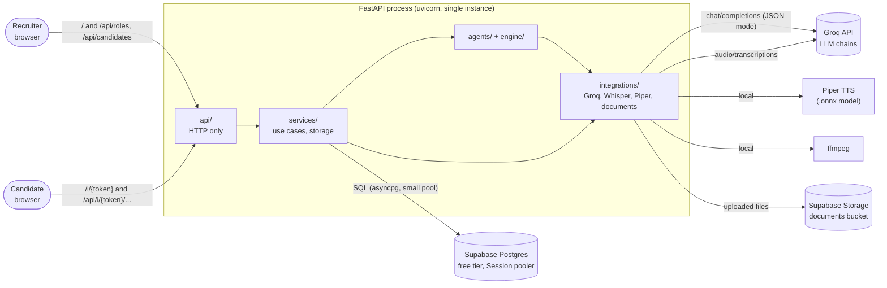
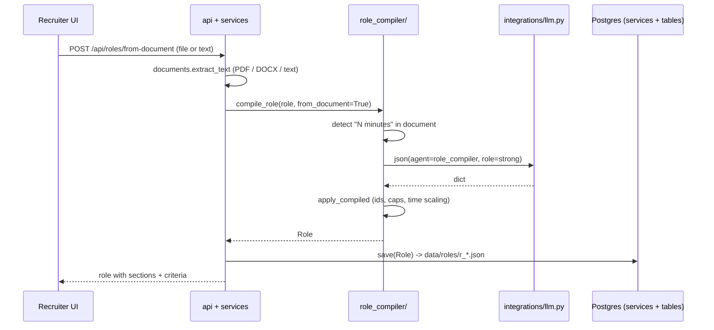
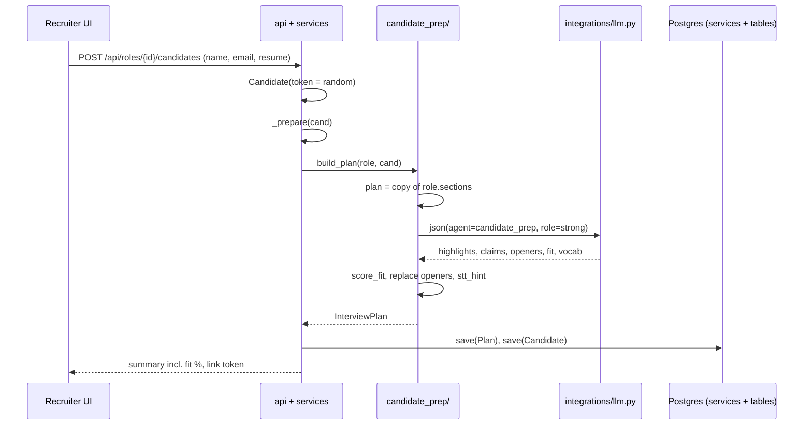
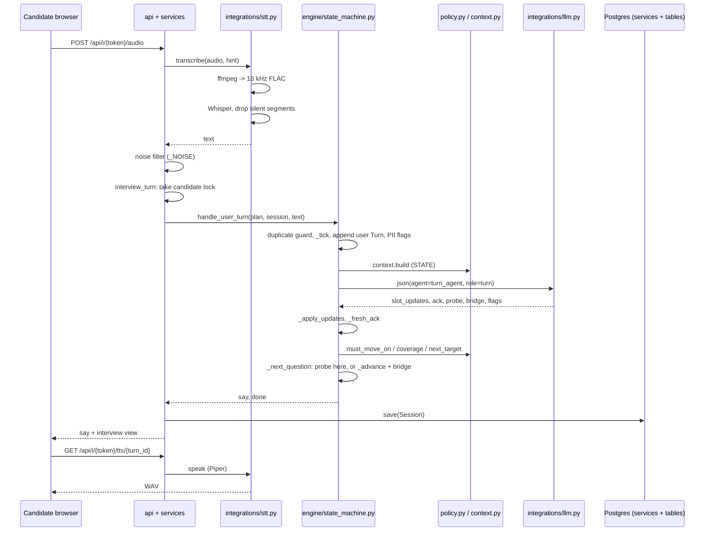
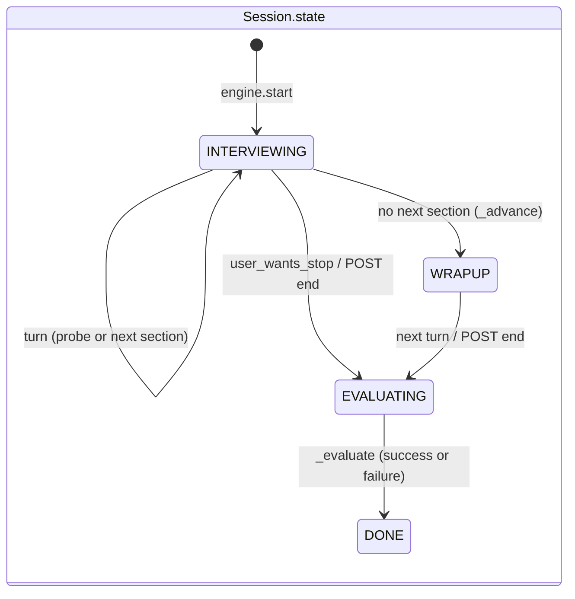
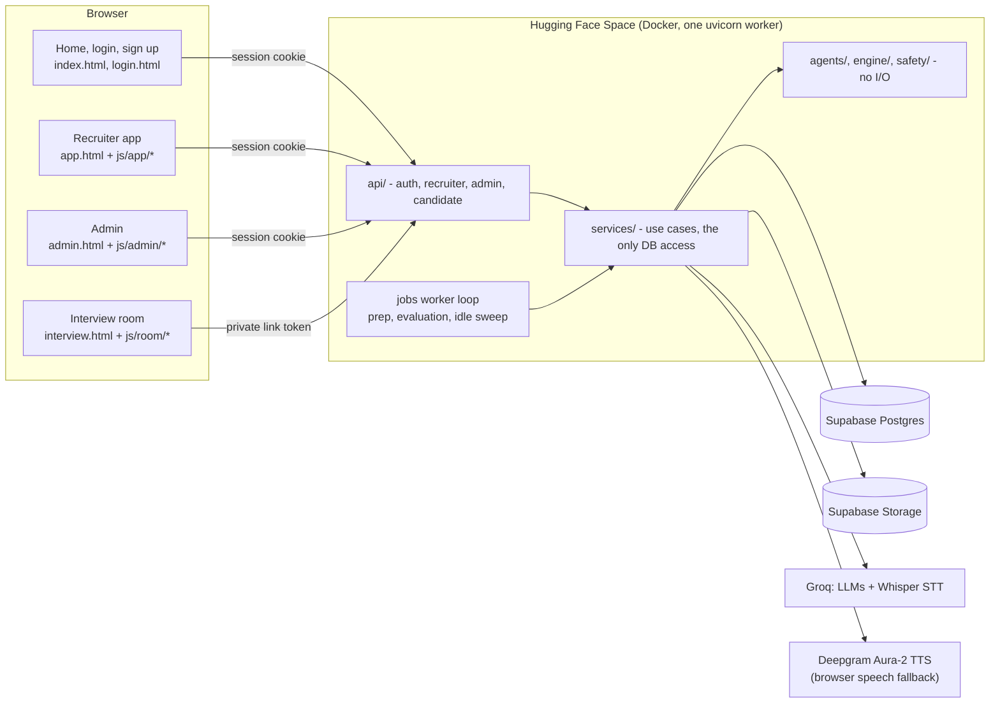
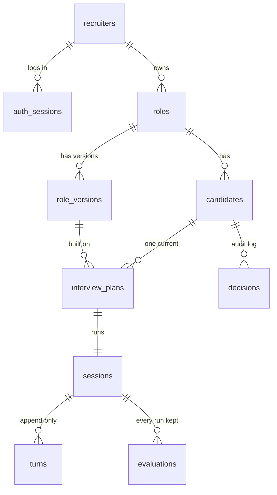

# Tryout - Backend System Design

A map of the backend: how the pieces fit, which file does what, and how every request travels through the code.
Use it to find your way around. Links go to files; search the file for the named function.

- Part A describes the code **as it is today** (after Phase 3: api / services / agents / engine / integrations).
- Part B is the **v2 design** (HLD and LLD) for TASKS Phases 5 to 14; sections move into Part A as they are built.
- Problems found and the plan to fix them: [backend-audit.md](backend-audit.md).

---

# Part A - The backend today

## A1. System context



One process, no queue. Background work (evaluation) runs as `asyncio` tasks in the same process until Phase 5.
Services read in one short transaction, call the LLM with none open, then write in one transaction.

## A2. Layers

Read top to bottom: a layer may call the layers below it, never the ones above. Tests guard two of the rules
(`test_engine_has_no_llm_imports`, `test_prompt_starts_with_static_text`).

```
┌──────────────────────────────────────────────────────────────────────────────────────┐
│ api/          HTTP only: parse request, call ONE service function, shape JSON (views) │
├──────────────────────────────────────────────────────────────────────────────────────┤
│ services/     use cases; the only layer that touches storage and joins agents+engine  │
├───────────────────────────────────────────┬──────────────────────────────────────────┤
│ agents/   one folder per agent:            │ engine/   pure interview logic, no LLM,  │
│   prompt.md, spec.py (output model,        │           no I/O: state_machine, policy, │
│   AgentSpec, entry), tools.py (code checks)│           context, heuristics            │
│                                            │ safety/   PII regexes                    │
├───────────────────────────────────────────┴──────────────────────────────────────────┤
│ integrations/  llm.py (Groq chat, cooldowns, repair), groq.py (shared transport),     │
│                stt.py (Whisper), tts.py (Piper), documents.py (PDF / DOCX / text)     │
├──────────────────────────────────────────────────────────────────────────────────────┤
│ foundations    models.py (data shapes)  tables.py + db.py (Postgres)  config.py (.env) │
└──────────────────────────────────────────────────────────────────────────────────────┘
```

Errors cross layers as types, not HTTP codes: services raise `NotFound` (404) or `Invalid` (400), agents raise
`LLMError` (503), Whisper raises `VoiceError` (503). [app.py](../backend/app.py) maps them once.

## A3. File map

| Path | What it owns | Key entry points |
|------|--------------|------------------|
| [app.py](../backend/app.py) | Builds the app: lifespan, error mapping, routers, pages | - |
| [api/recruiter.py](../backend/api/recruiter.py) | `/api/roles`, `/api/candidates` routes and request models | see A4 |
| [api/candidate.py](../backend/api/candidate.py) | `/api/i/{token}/...` routes | see A4 |
| [api/views.py](../backend/api/views.py) | Domain objects -> JSON; candidate views never contain scores | `summary`, `interview`, `report` |
| [api/\_\_init\_\_.py](../backend/api/__init__.py) | Upload size caps | `read_upload` |
| [services/\_\_init\_\_.py](../backend/services/__init__.py) | `NotFound`, `Invalid`, per-candidate locks, `get` | - |
| [services/roles.py](../backend/services/roles.py) | Create, from document, refine, manual edit (validated) | `create`, `refine`, `update` |
| [services/candidates.py](../backend/services/candidates.py) | Invite, read resume, prepare retry, decide, reset, delete | `add`, `read_resume`, `prepare` |
| [services/interviews.py](../backend/services/interviews.py) | Start, answer (text / voice), interviewer audio, end; the one place a turn runs | `handle_user_turn`, `answer` |
| [services/sessions.py](../backend/services/sessions.py) | Load / save a session: engine state JSON, append-only turns and usage, one transaction per turn | `load`, `save` |
| [services/evaluation.py](../backend/services/evaluation.py) | Run the Evaluator now or in the background | `run`, `run_later`, `rerun` |
| [agents/base.py](../backend/agents/base.py) | Agent contract, prompt rendering, lenient output fields | `AgentSpec`, `run_agent`, `render` |
| [agents/role_compiler/](../backend/agents/role_compiler/) | `CompiledRole`; `apply_compiled` validates every brief | `compile_role` |
| [agents/role_refine/](../backend/agents/role_refine/) | Plain-language brief changes | `refine_role` |
| [agents/candidate_prep/](../backend/agents/candidate_prep/) | `PrepOut`; fit score, openers | `build_plan` |
| [agents/turn_agent/](../backend/agents/turn_agent/) | `TurnOut` and the spec; run by `services/interviews.py` | `SPEC` |
| [agents/evaluator/](../backend/agents/evaluator/) | `EvalOut`; quote checks, score bands, recommendation | `evaluate`, `build_report` |
| [engine/state_machine.py](../backend/engine/state_machine.py) | Session state: record answer, apply agent output, next question, end | `start`, `apply_turn` |
| [engine/policy.py](../backend/engine/policy.py) | Coverage, probe limits, time, scheduling | `must_move_on`, `next_target` |
| [engine/context.py](../backend/engine/context.py) | The STATE text the Turn Agent reads | `build` |
| [engine/heuristics.py](../backend/engine/heuristics.py) | No repeated questions or filler openers | `similar`, `fresh_ack` |
| [safety/pii.py](../backend/safety/pii.py) | Personal data regexes (flagged, never scored) | `find_pii` |
| [integrations/llm.py](../backend/integrations/llm.py) | Groq chat: model chains, shared cooldowns, one repair, usage; `FakeLLM` | `GroqLLM.json` |
| [integrations/groq.py](../backend/integrations/groq.py) | One HTTP connection pool for chat and Whisper | `client` |
| [integrations/stt.py](../backend/integrations/stt.py) | ffmpeg normalise (3 min cap, 30 s timeout), Whisper | `transcribe` |
| [integrations/tts.py](../backend/integrations/tts.py) | Piper voice | `speak`, `warm_up` |
| [integrations/storage.py](../backend/integrations/storage.py) | Original files to Supabase Storage (off without a secret key) | `upload` |
| [integrations/documents.py](../backend/integrations/documents.py) | PDF / DOCX / UTF-8 text | `extract_text` |
| [models.py](../backend/models.py) | Every data shape (Pydantic) | see A7 |
| [config.py](../backend/config.py) | `.env`: models per tier, interview rules, upload caps | `MODELS` |
| [tables.py](../backend/tables.py) | The 12 database tables (lean schema; nested data as JSON columns) | - |
| [db.py](../backend/db.py) | Engine (small pool for the free tier) and `transaction()` | `transaction` |
| [migrations/](../migrations/) | Alembic; `0001` creates the tables and turns on RLS | `alembic upgrade head` |

## A4. Route map

Every endpoint calls one service function.

### Recruiter ([api/recruiter.py](../backend/api/recruiter.py))

| Method + path | Service | Agents | Writes |
|---------------|---------|--------|--------|
| `POST /api/roles` | `roles.create` | Role Compiler | Role |
| `POST /api/roles/from-document` | `roles.from_document` | Role Compiler (`from_document=True`) | Role (+ original document) |
| `GET /api/roles` | `roles.list_all` | - | - |
| `GET /api/roles/{id}` | `roles.with_candidates` | - | - |
| `PUT /api/roles/{id}` | `roles.update` (validated like AI briefs) | - | Role |
| `POST /api/roles/{id}/refine` | `roles.refine` | Role Refine | Role |
| `POST /api/roles/{id}/candidates` | `candidates.add` | Candidate Prep (if resume given) | Candidate, Plan |
| `GET /api/candidates/{id}` | `candidates.report` | - | - |
| `POST /api/candidates/{id}/prepare` | `candidates.prepare` (503 if it fails again) | Candidate Prep | Plan |
| `POST /api/candidates/{id}/decision` | `candidates.decide` | - | Candidate.status |
| `POST /api/candidates/{id}/reset` | `candidates.reset` | - | deletes Session + Plan |
| `POST /api/candidates/{id}/reevaluate` | `evaluation.rerun` (503 on failure) | Evaluator | Session.report |
| `DELETE /api/candidates/{id}` | `candidates.delete` | - | deletes all |

### Candidate, by private link ([api/candidate.py](../backend/api/candidate.py))

| Method + path | Service | Agents | Writes |
|---------------|---------|--------|--------|
| `GET /api/i/{token}` | `interviews.info` | - | - |
| `POST /api/i/{token}/resume` | `candidates.upload_resume` | Candidate Prep | Candidate.resume, Plan |
| `POST /api/i/{token}/start` | `interviews.start` (idempotent) | Candidate Prep if no plan | Session, Candidate |
| `POST /api/i/{token}/turn` | `interviews.answer` | Turn Agent (none on the wrap-up answer); Evaluator in background when done | Session |
| `POST /api/i/{token}/audio` | `interviews.answer_audio` | Whisper, then as `/turn` | Session |
| `GET /api/i/{token}/tts/{turn_id}` | `interviews.speak` | Piper | - |
| `POST /api/i/{token}/end` | `interviews.end` | Evaluator in background | Session.state |
| `POST /api/i/{token}/rating` | `interviews.rate` (only after the interview ends) | - | Session.experience |

### Pages and ops ([app.py](../backend/app.py))

| Path | Serves |
|------|--------|
| `GET /` | `frontend/recruiter.html` |
| `GET /i/{token}` | `frontend/interview.html` |
| `/static/*` | `frontend/` |
| `GET /api/health` | key present, model chains |

### Recruiter screens ([recruiter.js](../frontend/recruiter.js), hash routes)

Shell: a fixed sidebar (Roles) and a top bar with a Back button and breadcrumbs.
Reads go through a small cache in `recruiter.js` (`get`): a page draws from the last copy at once, asks the server
again in the background and redraws only if the answer changed; every write (`send`) clears the cache.
Styles: [style.css](../frontend/style.css) on [tokens.css](../frontend/tokens.css) + [base.css](../frontend/base.css)
(Hallmark Cobalt palette, Familjen Grotesk heads, IBM Plex Sans body, one 1.2 type scale, 14px minimum).
The candidate room ([interview.html](../frontend/interview.html)) uses the same light system for the lobby
(device check, resume, consent), the call and the end screen ([call.css](../frontend/call.css)). The call shows
"Part N of M" from the session's sections, never coverage or scores; integrity notices appear as a side toast. Tab and
window switches are one check in the report, because browsers cannot reliably tell them apart.

| Route | Screen |
|-------|--------|
| `#/` | Roles table (candidates, interviewed, to review, length, brief version) and Create role |
| `#/new` | Create role: job description, upload or template, then build |
| `#/role/{id}[/candidates/{filter}]` | Candidates table with status filters, copy link, reset, delete, compare picks |
| `#/role/{id}/plan` | Interview plan: time bar, one row per section; Edit plan saves `sections` |
| `#/role/{id}/scoring` | Criteria with weight share, bars on expand; Edit scoring saves `criteria` |
| `#/role/{id}/settings` | Title, company, length, interviewer notes; the job description it was built from |
| `#/role/{id}/compare/{ids}` | Two to four candidates side by side |
| `#/report/{id}[/{tab}]` | Report: decision, stat strip, summary, then tabs (evidence, transcript, resume fit, integrity checks, the candidate's own rating). Download prints a separate report document, not the screen |

## A5. The agents

All five agents follow the same pattern: render a prompt, one `get_llm().json(...)` call, then plain code checks
and uses the result. None of them call tools or loop. "Tools" below means the code that processes their output.

```
run_agent(SPEC, **data) ──► llm.json(output=Model) ──► validated Model ──► code tools (tools.py)
  agents/<name>/prompt.md        integrations/llm.py: one repair on bad JSON or wrong shape, then next model
```

### Role Compiler
| | |
|---|---|
| Code | [`compile_role`](../backend/agents/role_compiler/spec.py) |
| Prompt | [agents/role_compiler/prompt.md](../backend/agents/role_compiler/prompt.md) |
| Tier / limits | strong, 7000 tokens, temp 0.2 |
| Called from | `create_role`, `role_from_document` |
| Input | title, JD or whole document, notes, time budget |
| Output | title, company, time_budget_sec, jd_summary, interviewer_notes, sections[slots], criteria |
| Code tools | regex length detection in the document; [`apply_compiled`](../backend/agents/role_compiler/tools.py): snake_case ids, dedupe, clamp weight and priority, scale section time to 85% |
| On failure | `LLMError` -> 503; empty sections or criteria -> 400 |

### Role Refine
| | |
|---|---|
| Code | [`refine_role`](../backend/agents/role_refine/spec.py) (own folder; reuses the compiler's `CompiledRole` and `apply_compiled`) |
| Prompt | [agents/role_refine/prompt.md](../backend/agents/role_refine/prompt.md) |
| Tier / limits | strong, 6000 tokens, temp 0.2 |
| Called from | `refine_role` route |
| Input | current sections and criteria, recruiter instruction |
| Output | sections, criteria |
| Code tools | `apply_compiled` |
| On failure | 503 / 400 |

### Candidate Prep
| | |
|---|---|
| Code | [`build_plan`](../backend/agents/candidate_prep/spec.py) |
| Prompt | [agents/candidate_prep/prompt.md](../backend/agents/candidate_prep/prompt.md) |
| Tier / limits | strong, 3000 tokens, temp 0.3 |
| Called from | `_prepare` (add candidate, resume upload, interview start without plan) |
| Input | role title, JD, sections, resume |
| Output | resume_highlights, claims_to_verify, openers per section, fit items, vocabulary |
| Code tools | [`score_fit`](../backend/agents/candidate_prep/tools.py) (fit % is arithmetic), opener must end in `?`, STT hint from vocabulary |
| On failure | swallowed: generic plan, no fit, no error shown |

### Turn Agent
| | |
|---|---|
| Code | [`handle_user_turn`](../backend/services/interviews.py) |
| Prompt | [agents/turn_agent/prompt.md](../backend/agents/turn_agent/prompt.md), STATE from [`context.build`](../backend/engine/context.py#L29) |
| Tier / limits | turn (fast), 1500 tokens, temp 0.5 |
| Called from | every candidate answer |
| Input | time, current section and slots, next section, resume highlights and claims, other sections, last 4 turns, latest answer |
| Output | slot_updates, ack, probe_question, gap, bridge_question, user_wants_skip, user_wants_stop, injection_suspected |
| Code tools | [`_apply_updates`](../backend/engine/state_machine.py), [`_fresh_ack`](../backend/engine/heuristics.py), [`_next_question`](../backend/engine/state_machine.py) with [`_similar`](../backend/engine/heuristics.py) dedupe, policy rules |
| On failure | interviewer says [`FALLBACK_SAY`](../backend/engine/state_machine.py); interview continues |

### Evaluator
| | |
|---|---|
| Code | [`evaluate`](../backend/agents/evaluator/spec.py) |
| Prompt | [agents/evaluator/prompt.md](../backend/agents/evaluator/prompt.md) |
| Tier / limits | strong, 6000 tokens, temp 0.2 |
| Called from | `_evaluate` (background after the interview, or `reevaluate`) |
| Input | criteria, resume highlights and claims, slot values, full transcript with timestamps |
| Output | per criterion rating, score, rationale, evidence quotes; summary, strengths, concerns, resume_flags, recommendation |
| Code tools | [`build_report`](../backend/agents/evaluator/tools.py): [`quote_found`](../backend/agents/evaluator/tools.py) per quote, unverified criteria excluded; scores 1-10 in bands (below 1-4, meets 5-7, above 8-10); weighted overall only when quote-backed criteria carry half the weight; reject under 5, advance from 6 |
| On failure | logged; session marked DONE with no report |

### Non-agent LLM calls
| Call | Code | Notes |
|------|------|-------|
| Whisper STT | [`voice.transcribe`](../backend/integrations/stt.py) | shared Groq transport; prompt = base vocab + plan `stt_hint` + last question |
| Sim candidate | [scripts/simulate.py](../scripts/simulate.py#L39) | dev only, uses the `aux` tier |

## A6. Main flows

### Flow 1 - Recruiter creates a role



### Flow 2 - Candidate is added and prepared



### Flow 3 - One interview turn (voice)



### Flow 4 - Interview ends and is evaluated

```mermaid
sequenceDiagram
    participant A as api + services
    participant EV as evaluator/
    participant L as integrations/llm.py
    participant S as Postgres (services + tables)
    Note over A: last turn returns done=true, or POST /end
    A->>A: _evaluate_later -> asyncio task
    A->>S: Session.state = EVALUATING
    A->>EV: evaluate(role, plan, session)
    EV->>L: json(agent=evaluator, role=strong)
    L-->>EV: ratings, quotes, summary, feedback
    EV->>EV: build_report: verify quotes, weighted score
    EV-->>A: Report
    A->>S: Session.report, state = DONE
    A->>S: Candidate.status = completed
    Note over A: Recruiter then: GET /api/candidates/{id}, decision; candidate: POST /api/i/{token}/rating
```

## A7. Data model

### Entities and files

```mermaid
classDiagram
    class Role {
      role_id, title, company, jd, notes, time_budget_sec
      sections: Target[]
      criteria: Criterion[]
    }
    class Target { target_id, name, intent, opening_question, time_budget_sec, priority, slots: Slot[] }
    class Slot { slot_id, desc, required }
    class Criterion { criterion_id, name, description, weight, above_bar, meets_bar, below_bar }
    class Candidate { candidate_id, token, role_id, name, email, resume, status, plan_id, session_id }
    class InterviewPlan { plan_id, role_id, candidate_id, targets: Target[] (copy), resume_highlights, claims_to_verify, fit, stt_hint }
    class Session { session_id, plan_id, candidate_id, state, elapsed_sec, current_target_id, targets: TargetState{}, turns: Turn[], flags: Flag[], usage: Usage[], report: Report }
    class TargetState { status, time_used_sec, probe_count, slots: SlotState{} }
    class Report { overall_score, recommendation, criteria: CriterionResult[], strengths, concerns, resume_flags }
    Role "1" --> "*" Target
    Target "1" --> "*" Slot
    Role "1" --> "*" Criterion
    Role "1" --> "*" Candidate
    Candidate "1" --> "0..1" InterviewPlan
    Candidate "1" --> "0..1" Session
    InterviewPlan "1" --> "1" Session
    Session "1" --> "*" TargetState
    Session "1" --> "0..1" Report
```

| Model | File on disk | Defined at |
|-------|--------------|-----------|
| Role (+ Target, Slot, Criterion) | `data/roles/r_*.json` | [models.py:21-58](../backend/models.py#L21-L58) |
| Candidate | `data/candidates/c_*.json` | [models.py:64-75](../backend/models.py#L64-L75) |
| InterviewPlan (+ Fit) | `data/plans/p_*.json` | [models.py:80-112](../backend/models.py#L80-L112) |
| Session (+ TargetState, SlotState, Turn, Flag, Usage, Report) | `data/sessions/s_*.json` | [models.py:118-213](../backend/models.py#L118-L213) |

### State machines



```
Candidate.status:  invited ──start──► in_progress ──evaluation──► completed ──decision──► advanced | hold | rejected
                      ▲                                                                         │
                      └───────────────────────────────── reset ─────────────────────────────────┘
```

Section (Target) status inside a session: `pending -> active -> satisfied | partial`, or `skipped` when time runs
out. Slot status: `missing | vague | filled | unknown | declined | conflict`; `filled / unknown / declined` count as
resolved for coverage.

## A8. Interview engine rules (where each decision is made)

| Decision | Rule | Code |
|----------|------|------|
| Section time used | wall-clock between user turns | [`_tick`](../backend/engine/state_machine.py) |
| Must leave section | < 45 s left overall, or 3 probes used, or > 1.5x section time, or > 1x time with >= 60% coverage | [`must_move_on`](../backend/engine/policy.py#L29) |
| Coverage | resolved required slots / required slots | [`coverage`](../backend/engine/policy.py#L17) |
| Next section | next pending in plan order; priority 3 skipped when behind schedule | [`next_target`](../backend/engine/policy.py#L46), [`behind_schedule`](../backend/engine/policy.py#L40) |
| Probe or move on | move on if must, if skip asked, if covered and nothing optional open, or if the agent gave no probe | [`_next_question`](../backend/engine/state_machine.py) |
| No repeated question | Jaccard word overlap >= 0.5 with the last 3 agent turns | [`_similar`](../backend/engine/heuristics.py) |
| Bridge question used | only if the engine went to the section the agent was shown | `_next_question` in [state_machine.py](../backend/engine/state_machine.py) |
| Wrap-up | no next section: "anything else?", next answer ends the interview | [`_advance`](../backend/engine/state_machine.py) |
| Limits | 2 probes per slot, 3 per section, 45 s wrap-up reserve | [policy.py:7-9](../backend/engine/policy.py#L7-L9) |

## A9. LLM client behaviour

All in [integrations/llm.py](../backend/integrations/llm.py) (`GroqLLM.json`), tested against a fake Groq server in
[tests/test_llm.py](../tests/test_llm.py).

| Concern | Behaviour |
|---------|-----------|
| Fallback | try the tier's models in order; a model with a real error is not retried in the same call |
| Rate limits | a 429 puts that model in a cooldown for as long as Groq says, shared by every request in the process; models in cooldown get no request; if all are cooling, wait only within the agent's `timeout_sec` (turn 15 s), else fail with no request |
| Reasoning params | `reasoning_effort` low / none; a model that rejects it is remembered, so it is rejected once, not once per call |
| Output | JSON mode, defensive parse, then the agent's Pydantic output model; one repair call on bad JSON or wrong shape |
| Usage | every answer records model, prompt version, HTTP calls (2 with a repair), prompt / cached / completion tokens, latency |
| Caching | prompts put fixed text first and per-call data last, so Groq's prefix cache hits (half price, not counted by rate limits) |
| Transport | one connection pool shared with Whisper ([integrations/groq.py](../backend/integrations/groq.py)) |
| Tests | `set_llm(FakeLLM({...}))`; the fake validates answers against the output model too |

## A10. Where do I look for...

| I want to change... | Go to |
|---------------------|-------|
| How the interviewer talks | [agents/turn_agent/prompt.md](../backend/agents/turn_agent/prompt.md) |
| The greeting / first question | [`engine.start`](../backend/engine/state_machine.py) |
| When the interview moves to the next section | [`policy.must_move_on`](../backend/engine/policy.py#L29), [`engine._next_question`](../backend/engine/state_machine.py) |
| Probe limits, wrap-up time | [policy.py:7-9](../backend/engine/policy.py#L7-L9) |
| What the Turn Agent can see | [`context.build`](../backend/engine/context.py#L29) |
| How sections and criteria are designed | [agents/role_compiler/prompt.md](../backend/agents/role_compiler/prompt.md), [`apply_compiled`](../backend/agents/role_compiler/tools.py) |
| Resume fit % | [`score_fit`](../backend/agents/candidate_prep/tools.py) |
| Personalised openers | [agents/candidate_prep/prompt.md](../backend/agents/candidate_prep/prompt.md), [`apply_prep`](../backend/agents/candidate_prep/tools.py) |
| How reports are scored | [`build_report`](../backend/agents/evaluator/tools.py) |
| Quote verification | [`quote_found`](../backend/agents/evaluator/tools.py) |
| Candidate feedback wording | [agents/evaluator/prompt.md](../backend/agents/evaluator/prompt.md) |
| Injection / data-not-instructions rule | [agents/_shared.md](../backend/agents/_shared.md) |
| PII detection | [`PII_PATTERNS`](../backend/engine/policy.py#L65) |
| Models, fallback chains | `.env` `MODEL_*`, [config.py](../backend/config.py) |
| Rate-limit handling | [`GroqLLM._call`](../backend/integrations/llm.py) |
| Speech-to-text accuracy | [`BASE_VOCAB`](../backend/integrations/stt.py), [`_prompt`](../backend/integrations/stt.py), plan `stt_hint` |
| Silence / noise answers | [`voice.transcribe`](../backend/integrations/stt.py), [`_NOISE`](../backend/services/interviews.py) |
| Interviewer voice | `.env` `PIPER_MODEL`, [`_synth`](../backend/integrations/tts.py) |
| What the candidate can see | [`views.interview`](../backend/api/views.py) |
| What the recruiter list shows | [`views.summary`](../backend/api/views.py) |
| Where data is saved | [tables.py](../backend/tables.py) (Postgres via `DATABASE_URL`); uploads in Supabase Storage |
| Tests with a fake LLM | [tests/conftest.py](../tests/conftest.py) fixtures; one file per area in [tests/](../tests/) |
| End-to-end run with the real LLM | [scripts/simulate.py](../scripts/simulate.py), `./run.sh sim vague` |

---

# Part B - v2 design

What v2 adds and how it fits the code in Part A. Requirements: [requirements.md](requirements.md). Tasks:
[tasks.md](tasks.md) Phases 5 to 14. Sections move into Part A as each phase is built.

## B1. High-level design



Why one process: the free Space gives one container. Async I/O lets one worker serve many interviews at once,
because every slow step (LLM, STT) is a network wait. Correctness never depends on being the only process: jobs are
claimed with `FOR UPDATE SKIP LOCKED` and turn writes check a version column, so a second instance would be safe.

The real ceiling is the Groq free tier (requests and tokens per minute), not the server. Admission control (B5)
turns that limit into a clear message instead of slow or failed turns.

## B2. Users and access

| Who | Proves identity with | Can reach |
|-----|---------------------|-----------|
| Visitor | nothing | home, login, sign up, demo report |
| Recruiter (pending) | session cookie | own profile, demo account data (read-only) |
| Recruiter (active) | session cookie | own roles, candidates, interviews, reports |
| Admin | session cookie + `is_admin` | admin pages, plus everything a recruiter can do with their own data |
| Candidate | private link token (hashed in DB) | their own interview, only inside its window |

Rules:
- Sessions: random 32-byte token in an HttpOnly, Secure, SameSite=Lax cookie; only its SHA-256 is stored, so a
  database leak cannot log anyone in. 14-day expiry; logout deletes the row.
- Passwords: `hashlib.scrypt` with a random salt (standard library, no new dependency).
- CSRF: SameSite=Lax plus JSON-only bodies on mutating routes (a cross-site form cannot send JSON).
- Ownership is checked in services, never in the frontend. Someone else's id returns 404, the same as a missing one.

## B3. Data model (v2)

Changes on top of Part A's schema, all in migration `0004`:

| Table | Change | Why |
|-------|--------|-----|
| `recruiters` | + `name`, `status` (pending/active/disabled), `is_admin` | approval flow, admin |
| `auth_sessions` | new: `token_hash` (unique), `recruiter_id`, `expires_at` | login sessions |
| `roles` | `recruiter_id` not null, indexed | ownership; every list query starts here |
| `candidates` | `token` becomes `token_hash`; + `opens_at`, `closes_at`; drop `feedback_released` | hashed links, scheduling |
| `role_versions` | brief gains `integrity` (standard/strict) | strict mode per role |
| `sessions` | + `version` integer | stale-write check (B5) |
| `jobs` | used (exists) | persisted background work |
| `decisions` | used (exists) | decision audit log |



Ownership path: `recruiter -> roles -> candidates -> plans -> sessions`. Services join from `roles.recruiter_id` once,
through one helper, instead of each query repeating the check.

Storage budget (500 MB free): text only. No audio is stored; original uploads go to Storage (1 GB free). A 10-minute
interview is about 30 turns of text plus one report, a few tens of KB.

## B4. Backend layout (v2)

New files are marked `+`. Layer rules from Part A stay: api calls one service function per route; only services
touch the database; agents and the engine do no I/O.

```
backend/
  app.py                 builds the app, mounts pages, starts and stops the jobs loop
  config.py  db.py  tables.py  models.py
  api/
    deps.py            + current_recruiter, current_admin, candidate_by_token
    auth.py            + sign up, log in, log out, me
    admin.py           + recruiters, approve, disable, usage, live interviews
    recruiter.py         roles, candidates, schedule, invite, reports, trace
    candidate.py         the interview by private link
    views.py             response shapes
  services/
    accounts.py        + passwords, sessions, approval
    jobs.py            + enqueue, claim, run, retry, requeue, idle sweep
    roles.py  candidates.py  interviews.py  evaluation.py  sessions.py
  agents/  engine/  integrations/   unchanged structure
  safety/
    pii.py  integrity.py (+ strict checks)
```

## B5. Concurrency and async work

| Concern | Design |
|---------|--------|
| Slow LLM calls | No DB transaction is open during an LLM or STT call (read, call, write). A slow model never holds one of the few pooled connections. |
| Two writes to one interview | `sessions.version`: the turn write is `UPDATE ... WHERE id = ? AND version = ?`; zero rows means someone else wrote first, so the request gets 409 and the room reloads state. The in-memory per-candidate lock stays as a fast path within one process. |
| Two tabs on one link | The room sends a client id; a turn from a different client than the one holding the interview gets 409 ("this interview is open in another tab"). |
| Background work | `jobs` rows. The worker loop claims one due job with `FOR UPDATE SKIP LOCKED`, runs it, records the result or the error with backoff. Max 3 attempts. |
| Restart | On startup, `running` jobs go back to `queued`. Interviews keep their state in the DB, so the room continues after a reload. |
| Abandoned interviews | The same loop ends interviews with no turn for 10 minutes and queues their evaluation. |
| Capacity | `MAX_LIVE_INTERVIEWS`: count of sessions in progress with activity in the last 2 minutes. Over the limit, start returns 503 with a retry message. |
| LLM rate limits | Already shared in `integrations/llm.py`: limited models are skipped until their limit clears. |
| Memory | Per-candidate locks are removed when released; no voice model in memory (hosted TTS); no transcript or audio is cached in memory between requests. |
| DB connections | Pool 3 + 2 overflow on the Supabase pooler. Requests hold a connection only for their short read and write. |

## B6. Agent context management

| Agent | Gets | Bounded by |
|-------|------|-----------|
| Turn Agent | instructions, section intent, slot states (the memory), next section's bridge question, resume highlights, claims to verify, last 4 turns | slots are short and fixed per section; transcript is never sent whole |
| Evaluator | brief, criteria, full transcript, plan | interview time budget (about 30 turns) |
| Candidate Prep | brief, resume text | resume capped at upload |
| Role Compiler / Refine | JD or document text, notes | document capped at upload |

Fixed instructions first, per-call data last, so Groq's prompt cache hits on the prefix (Phase 2.8). Phase 9.1 adds a
test that the Turn Agent input stays under a token limit at turn 40.

Intent regulation: the Turn Agent proposes (slot updates, the gap to probe, the reply, `injection_suspected`). The
engine decides: section changes, timing, probe limits, and, from Phase 9.2, replacing a reply that would answer the
question for the candidate, and holding the section when injection is flagged.

## B7. Integrity (strict mode)

| Check | Standard | Strict | How |
|-------|----------|--------|-----|
| Tab switch, window focus loss | logged | logged, interview pauses | `visibilitychange`, `blur` |
| Full screen | asked | required to start and to continue | Fullscreen API |
| Copy, paste, right-click, select | logged | blocked and logged | DOM events, `preventDefault` |
| Second screen | logged | logged | `screen.isExtended` |
| Second tab on the link | 409 | 409 | client id (B5) |
| Browser extensions | logged | start blocked when one is found | known injected markers, `chrome-extension://` resources, unknown injected elements |

Limits, stated in the lobby and the report: a web page cannot list or switch off extensions, a phone browser has no
reliable full-screen lock, and a second device is invisible. Signals are shown on the report timeline and never
change the score.

## B8. Frontend layout (v2)

Vanilla ES modules, no build step. Pages are separate HTML files so each loads only its own code.

```
frontend/
  index.html  login.html  signup.html  app.html  admin.html  interview.html
  assets/      logo.svg  favicon.svg
  css/         tokens.css  base.css  components.css  app.css  room.css  home.css
  js/lib/      api.js (fetch + errors + 401 redirect)  store.js  router.js  dom.js  ui.js
  js/app/      roles.js  role.js  candidates.js  report.js  compare.js  trace.js
  js/admin/    recruiters.js  usage.js
  js/room/     lobby.js  room.js  voice.js  integrity.js
```

State: `store.js` holds one plain object per page with `get`, `set` and `subscribe`; screens render from it.
Server data is fetched by the screen that shows it and kept only while that screen is open. The route (screen and
ids) lives in the URL hash, so reload and back work.

## B9. Deployment

```
GitHub repo --(push)--> GitHub Actions: ruff + pytest
           --(sync)--> Hugging Face Space (Docker)
                         Dockerfile: python:3.12-slim + ffmpeg + uv
                         start: alembic upgrade head && uvicorn backend.app:app --port 7860
                         secrets: DATABASE_URL, GROQ_API_KEY, DEEPGRAM_API_KEY, SUPABASE_*, ADMIN_EMAIL, SESSION_SECRET
                       -> Supabase prod project (Mumbai) for Postgres and Storage
```

## B10. Testing

| Level | What | Where |
|-------|------|-------|
| Unit | agent tools, engine rules, integrity summary, password and token hashing | `tests/` with the fake LLM |
| Service | each flow end to end on in-memory SQLite | `tests/test_flow.py` and new files per phase |
| Access | every route: 401 logged out, 404 on another recruiter's ids, admin-only refused | one parametrised test over the route list |
| Concurrency | job claimed once, restart requeue, stale write 409, admission limit | `tests/test_jobs.py`, `tests/test_concurrency.py` |
| Real LLM | sim personas strong, vague, bluffer, injector | `./run.sh sim` |
| UI | manual checklist per screen at 375, 768 and 1280 px | TASKS Phase 12.6 |
