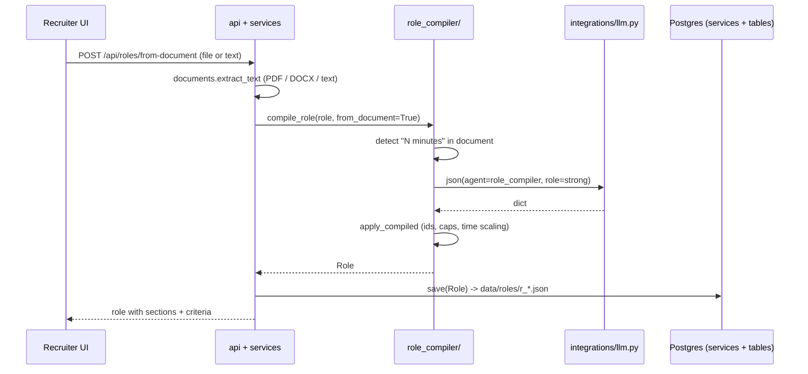
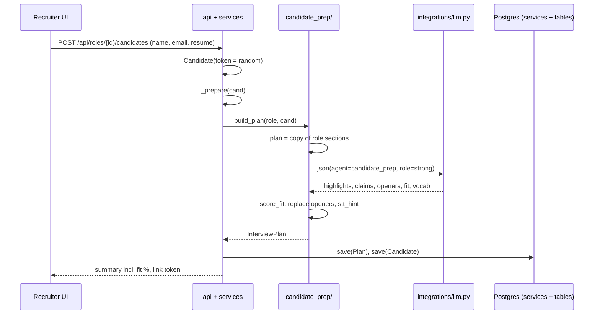
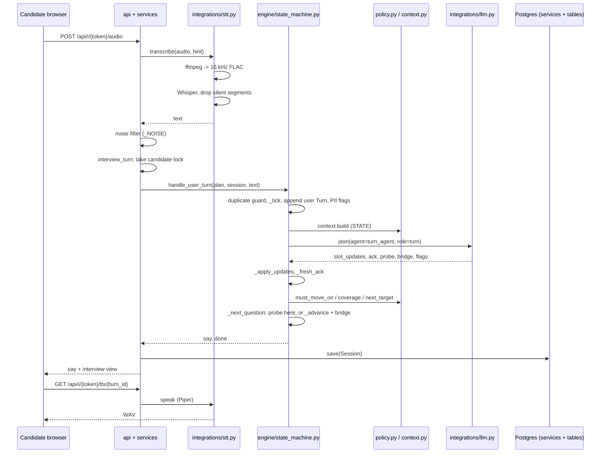
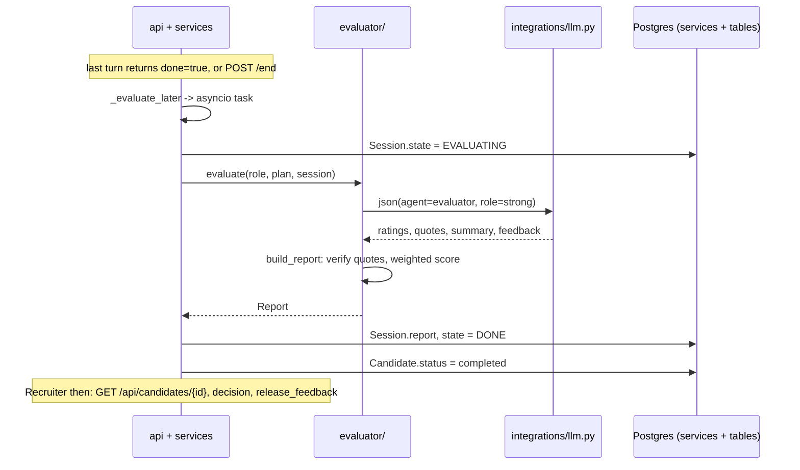
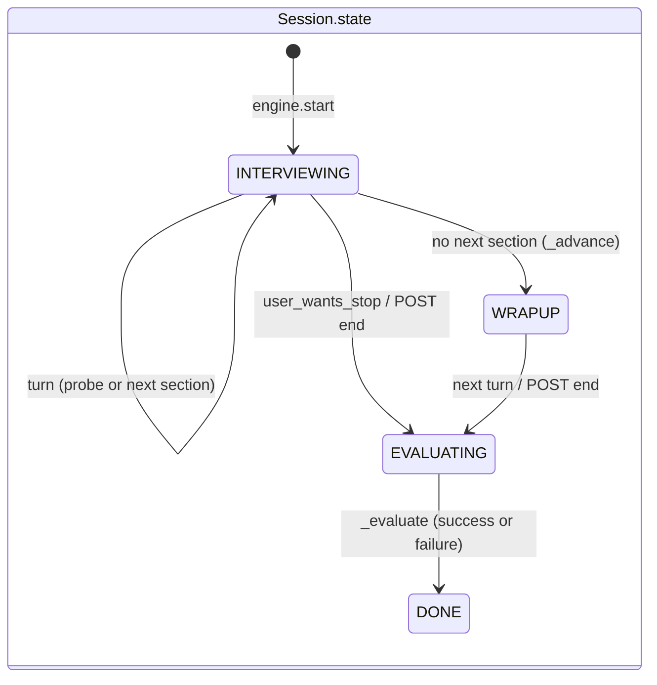
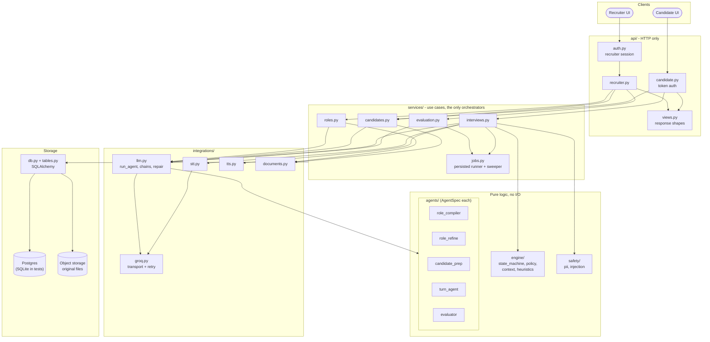

# Tryout - Backend System Design

A map of the backend: how the pieces fit, which file does what, and how every request travels through the code.
Use it to find your way around. Links go to files; search the file for the named function.

- Part A describes the code **as it is today** (after Phase 3: api / services / agents / engine / integrations).
- Part B describes the **target design** and maps each current file to its future home.
- Problems found and the plan to fix them: [backend-audit.md](backend-audit.md).

---

# Part A - The backend today

## A1. System context


One process, no queue. Background work (evaluation) runs as `asyncio` tasks in the same process until Phase 5.
Services read in one short transaction, call the LLM with none open, then write in one transaction.

## A2. Layers

Read top to bottom: a layer may call the layers below it, never the ones above. Tests guard two of the rules
(`test_engine_has_no_llm_imports`, `test_prompt_starts_with_static_text`).

```
┌──────────────────────────────────────────────────────────────────────────────────────┐
│ api/          HTTP only: parse request, call ONE service function, shape JSON (views) │
├──────────────────────────────────────────────────────────────────────────────────────┤
│ services/     use cases; the only layer that touches storage and joins agents+engine  │
├───────────────────────────────────────────┬──────────────────────────────────────────┤
│ agents/   one folder per agent:            │ engine/   pure interview logic, no LLM,  │
│   prompt.md, spec.py (output model,        │           no I/O: state_machine, policy, │
│   AgentSpec, entry), tools.py (code checks)│           context, heuristics            │
│                                            │ safety/   PII regexes                    │
├───────────────────────────────────────────┴──────────────────────────────────────────┤
│ integrations/  llm.py (Groq chat, cooldowns, repair), groq.py (shared transport),     │
│                stt.py (Whisper), tts.py (Piper), documents.py (PDF / DOCX / text)     │
├──────────────────────────────────────────────────────────────────────────────────────┤
│ foundations    models.py (data shapes)  tables.py + db.py (Postgres)  config.py (.env) │
└──────────────────────────────────────────────────────────────────────────────────────┘
```

Errors cross layers as types, not HTTP codes: services raise `NotFound` (404) or `Invalid` (400), agents raise
`LLMError` (503), Whisper raises `VoiceError` (503). [app.py](../backend/app.py) maps them once.

## A3. File map

| Path | What it owns | Key entry points |
|------|--------------|------------------|
| [app.py](../backend/app.py) | Builds the app: lifespan, error mapping, routers, pages | - |
| [api/recruiter.py](../backend/api/recruiter.py) | `/api/roles`, `/api/candidates` routes and request models | see A4 |
| [api/candidate.py](../backend/api/candidate.py) | `/api/i/{token}/...` routes | see A4 |
| [api/views.py](../backend/api/views.py) | Domain objects -> JSON; candidate views never contain scores | `summary`, `interview`, `report` |
| [api/\_\_init\_\_.py](../backend/api/__init__.py) | Upload size caps | `read_upload` |
| [services/\_\_init\_\_.py](../backend/services/__init__.py) | `NotFound`, `Invalid`, per-candidate locks, `get` | - |
| [services/roles.py](../backend/services/roles.py) | Create, from document, refine, manual edit (validated) | `create`, `refine`, `update` |
| [services/candidates.py](../backend/services/candidates.py) | Invite, read resume, prepare retry, decide, reset, delete | `add`, `read_resume`, `prepare` |
| [services/interviews.py](../backend/services/interviews.py) | Start, answer (text / voice), interviewer audio, end; the one place a turn runs | `handle_user_turn`, `answer` |
| [services/sessions.py](../backend/services/sessions.py) | Load / save a session: engine state JSON, append-only turns and usage, one transaction per turn | `load`, `save` |
| [services/evaluation.py](../backend/services/evaluation.py) | Run the Evaluator now or in the background | `run`, `run_later`, `rerun` |
| [agents/base.py](../backend/agents/base.py) | Agent contract, prompt rendering, lenient output fields | `AgentSpec`, `run_agent`, `render` |
| [agents/role_compiler/](../backend/agents/role_compiler/) | `CompiledRole`; `apply_compiled` validates every brief | `compile_role` |
| [agents/role_refine/](../backend/agents/role_refine/) | Plain-language brief changes | `refine_role` |
| [agents/candidate_prep/](../backend/agents/candidate_prep/) | `PrepOut`; fit score, openers | `build_plan` |
| [agents/turn_agent/](../backend/agents/turn_agent/) | `TurnOut` and the spec; run by `services/interviews.py` | `SPEC` |
| [agents/evaluator/](../backend/agents/evaluator/) | `EvalOut`; quote checks, score bands, recommendation | `evaluate`, `build_report` |
| [engine/state_machine.py](../backend/engine/state_machine.py) | Session state: record answer, apply agent output, next question, end | `start`, `apply_turn` |
| [engine/policy.py](../backend/engine/policy.py) | Coverage, probe limits, time, scheduling | `must_move_on`, `next_target` |
| [engine/context.py](../backend/engine/context.py) | The STATE text the Turn Agent reads | `build` |
| [engine/heuristics.py](../backend/engine/heuristics.py) | No repeated questions or filler openers | `similar`, `fresh_ack` |
| [safety/pii.py](../backend/safety/pii.py) | Personal data regexes (flagged, never scored) | `find_pii` |
| [integrations/llm.py](../backend/integrations/llm.py) | Groq chat: model chains, shared cooldowns, one repair, usage; `FakeLLM` | `GroqLLM.json` |
| [integrations/groq.py](../backend/integrations/groq.py) | One HTTP connection pool for chat and Whisper | `client` |
| [integrations/stt.py](../backend/integrations/stt.py) | ffmpeg normalise (3 min cap, 30 s timeout), Whisper | `transcribe` |
| [integrations/tts.py](../backend/integrations/tts.py) | Piper voice | `speak`, `warm_up` |
| [integrations/storage.py](../backend/integrations/storage.py) | Original files to Supabase Storage (off without a secret key) | `upload` |
| [integrations/documents.py](../backend/integrations/documents.py) | PDF / DOCX / UTF-8 text | `extract_text` |
| [models.py](../backend/models.py) | Every data shape (Pydantic) | see A7 |
| [config.py](../backend/config.py) | `.env`: models per tier, interview rules, upload caps | `MODELS` |
| [tables.py](../backend/tables.py) | The 12 database tables (lean schema; nested data as JSON columns) | - |
| [db.py](../backend/db.py) | Engine (small pool for the free tier) and `transaction()` | `transaction` |
| [migrations/](../migrations/) | Alembic; `0001` creates the tables and turns on RLS | `alembic upgrade head` |

## A4. Route map

Every endpoint calls one service function.

### Recruiter ([api/recruiter.py](../backend/api/recruiter.py))

| Method + path | Service | Agents | Writes |
|---------------|---------|--------|--------|
| `POST /api/roles` | `roles.create` | Role Compiler | Role |
| `POST /api/roles/from-document` | `roles.from_document` | Role Compiler (`from_document=True`) | Role (+ original document) |
| `GET /api/roles` | `roles.list_all` | - | - |
| `GET /api/roles/{id}` | `roles.with_candidates` | - | - |
| `PUT /api/roles/{id}` | `roles.update` (validated like AI briefs) | - | Role |
| `POST /api/roles/{id}/refine` | `roles.refine` | Role Refine | Role |
| `POST /api/roles/{id}/candidates` | `candidates.add` | Candidate Prep (if resume given) | Candidate, Plan |
| `GET /api/candidates/{id}` | `candidates.report` | - | - |
| `POST /api/candidates/{id}/prepare` | `candidates.prepare` (503 if it fails again) | Candidate Prep | Plan |
| `POST /api/candidates/{id}/decision` | `candidates.decide` | - | Candidate.status |
| `POST /api/candidates/{id}/release_feedback` | `candidates.release_feedback` | - | Candidate |
| `POST /api/candidates/{id}/reset` | `candidates.reset` | - | deletes Session + Plan |
| `POST /api/candidates/{id}/reevaluate` | `evaluation.rerun` (503 on failure) | Evaluator | Session.report |
| `DELETE /api/candidates/{id}` | `candidates.delete` | - | deletes all |

### Candidate, by private link ([api/candidate.py](../backend/api/candidate.py))

| Method + path | Service | Agents | Writes |
|---------------|---------|--------|--------|
| `GET /api/i/{token}` | `interviews.info` | - | - |
| `POST /api/i/{token}/resume` | `candidates.upload_resume` | Candidate Prep | Candidate.resume, Plan |
| `POST /api/i/{token}/start` | `interviews.start` (idempotent) | Candidate Prep if no plan | Session, Candidate |
| `POST /api/i/{token}/turn` | `interviews.answer` | Turn Agent (none on the wrap-up answer); Evaluator in background when done | Session |
| `POST /api/i/{token}/audio` | `interviews.answer_audio` | Whisper, then as `/turn` | Session |
| `GET /api/i/{token}/tts/{turn_id}` | `interviews.speak` | Piper | - |
| `POST /api/i/{token}/end` | `interviews.end` | Evaluator in background | Session.state |

### Pages and ops ([app.py](../backend/app.py))

| Path | Serves |
|------|--------|
| `GET /` | `frontend/recruiter.html` |
| `GET /i/{token}` | `frontend/interview.html` |
| `/static/*` | `frontend/` |
| `GET /api/health` | key present, model chains |

## A5. The agents

All five agents follow the same pattern: render a prompt, one `get_llm().json(...)` call, then plain code checks
and uses the result. None of them call tools or loop. "Tools" below means the code that processes their output.

```
run_agent(SPEC, **data) ──► llm.json(output=Model) ──► validated Model ──► code tools (tools.py)
  agents/<name>/prompt.md        integrations/llm.py: one repair on bad JSON or wrong shape, then next model
```

### Role Compiler
| | |
|---|---|
| Code | [`compile_role`](../backend/agents/role_compiler/spec.py) |
| Prompt | [agents/role_compiler/prompt.md](../backend/agents/role_compiler/prompt.md) |
| Tier / limits | strong, 7000 tokens, temp 0.2 |
| Called from | `create_role`, `role_from_document` |
| Input | title, JD or whole document, notes, time budget |
| Output | title, company, time_budget_sec, jd_summary, interviewer_notes, sections[slots], criteria |
| Code tools | regex length detection in the document; [`apply_compiled`](../backend/agents/role_compiler/tools.py): snake_case ids, dedupe, clamp weight and priority, scale section time to 85% |
| On failure | `LLMError` -> 503; empty sections or criteria -> 400 |

### Role Refine
| | |
|---|---|
| Code | [`refine_role`](../backend/agents/role_refine/spec.py) (own folder; reuses the compiler's `CompiledRole` and `apply_compiled`) |
| Prompt | [agents/role_refine/prompt.md](../backend/agents/role_refine/prompt.md) |
| Tier / limits | strong, 6000 tokens, temp 0.2 |
| Called from | `refine_role` route |
| Input | current sections and criteria, recruiter instruction |
| Output | sections, criteria |
| Code tools | `apply_compiled` |
| On failure | 503 / 400 |

### Candidate Prep
| | |
|---|---|
| Code | [`build_plan`](../backend/agents/candidate_prep/spec.py) |
| Prompt | [agents/candidate_prep/prompt.md](../backend/agents/candidate_prep/prompt.md) |
| Tier / limits | strong, 3000 tokens, temp 0.3 |
| Called from | `_prepare` (add candidate, resume upload, interview start without plan) |
| Input | role title, JD, sections, resume |
| Output | resume_highlights, claims_to_verify, openers per section, fit items, vocabulary |
| Code tools | [`score_fit`](../backend/agents/candidate_prep/tools.py) (fit % is arithmetic), opener must end in `?`, STT hint from vocabulary |
| On failure | swallowed: generic plan, no fit, no error shown |

### Turn Agent
| | |
|---|---|
| Code | [`handle_user_turn`](../backend/services/interviews.py) |
| Prompt | [agents/turn_agent/prompt.md](../backend/agents/turn_agent/prompt.md), STATE from [`context.build`](../backend/engine/context.py#L29) |
| Tier / limits | turn (fast), 1500 tokens, temp 0.5 |
| Called from | every candidate answer |
| Input | time, current section and slots, next section, resume highlights and claims, other sections, last 4 turns, latest answer |
| Output | slot_updates, ack, probe_question, gap, bridge_question, user_wants_skip, user_wants_stop, injection_suspected |
| Code tools | [`_apply_updates`](../backend/engine/state_machine.py), [`_fresh_ack`](../backend/engine/heuristics.py), [`_next_question`](../backend/engine/state_machine.py) with [`_similar`](../backend/engine/heuristics.py) dedupe, policy rules |
| On failure | interviewer says [`FALLBACK_SAY`](../backend/engine/state_machine.py); interview continues |

### Evaluator
| | |
|---|---|
| Code | [`evaluate`](../backend/agents/evaluator/spec.py) |
| Prompt | [agents/evaluator/prompt.md](../backend/agents/evaluator/prompt.md) |
| Tier / limits | strong, 6000 tokens, temp 0.2 |
| Called from | `_evaluate` (background after the interview, or `reevaluate`) |
| Input | criteria, resume highlights and claims, slot values, full transcript with timestamps |
| Output | per criterion rating, score, rationale, evidence quotes; summary, strengths, concerns, resume_flags, recommendation, candidate_feedback |
| Code tools | [`build_report`](../backend/agents/evaluator/tools.py): [`quote_found`](../backend/agents/evaluator/tools.py) per quote, unverified criteria excluded, weighted score |
| On failure | logged; session marked DONE with no report |

### Non-agent LLM calls
| Call | Code | Notes |
|------|------|-------|
| Whisper STT | [`voice.transcribe`](../backend/integrations/stt.py) | shared Groq transport; prompt = base vocab + plan `stt_hint` + last question |
| Sim candidate | [scripts/simulate.py](../scripts/simulate.py#L39) | dev only, uses the `aux` tier |

## A6. Main flows

### Flow 1 - Recruiter creates a role



### Flow 2 - Candidate is added and prepared



### Flow 3 - One interview turn (voice)



### Flow 4 - Interview ends and is evaluated



## A7. Data model

### Entities and files

```mermaid
classDiagram
    class Role {
      role_id, title, company, jd, notes, time_budget_sec
      sections: Target[]
      criteria: Criterion[]
    }
    class Target { target_id, name, intent, opening_question, time_budget_sec, priority, slots: Slot[] }
    class Slot { slot_id, desc, required }
    class Criterion { criterion_id, name, description, weight, above_bar, meets_bar, below_bar }
    class Candidate { candidate_id, token, role_id, name, email, resume, status, plan_id, session_id, feedback_released }
    class InterviewPlan { plan_id, role_id, candidate_id, targets: Target[] (copy), resume_highlights, claims_to_verify, fit, stt_hint }
    class Session { session_id, plan_id, candidate_id, state, elapsed_sec, current_target_id, targets: TargetState{}, turns: Turn[], flags: Flag[], usage: Usage[], report: Report }
    class TargetState { status, time_used_sec, probe_count, slots: SlotState{} }
    class Report { overall_score, recommendation, criteria: CriterionResult[], strengths, concerns, resume_flags, candidate_feedback }
    Role "1" --> "*" Target
    Target "1" --> "*" Slot
    Role "1" --> "*" Criterion
    Role "1" --> "*" Candidate
    Candidate "1" --> "0..1" InterviewPlan
    Candidate "1" --> "0..1" Session
    InterviewPlan "1" --> "1" Session
    Session "1" --> "*" TargetState
    Session "1" --> "0..1" Report
```

| Model | File on disk | Defined at |
|-------|--------------|-----------|
| Role (+ Target, Slot, Criterion) | `data/roles/r_*.json` | [models.py:21-58](../backend/models.py#L21-L58) |
| Candidate | `data/candidates/c_*.json` | [models.py:64-75](../backend/models.py#L64-L75) |
| InterviewPlan (+ Fit) | `data/plans/p_*.json` | [models.py:80-112](../backend/models.py#L80-L112) |
| Session (+ TargetState, SlotState, Turn, Flag, Usage, Report) | `data/sessions/s_*.json` | [models.py:118-213](../backend/models.py#L118-L213) |

### State machines



```
Candidate.status:  invited ──start──► in_progress ──evaluation──► completed ──decision──► advanced | hold | rejected
                      ▲                                                                         │
                      └───────────────────────────────── reset ─────────────────────────────────┘
```

Section (Target) status inside a session: `pending -> active -> satisfied | partial`, or `skipped` when time runs
out. Slot status: `missing | vague | filled | unknown | declined | conflict`; `filled / unknown / declined` count as
resolved for coverage.

## A8. Interview engine rules (where each decision is made)

| Decision | Rule | Code |
|----------|------|------|
| Section time used | wall-clock between user turns | [`_tick`](../backend/engine/state_machine.py) |
| Must leave section | < 45 s left overall, or 3 probes used, or > 1.5x section time, or > 1x time with >= 60% coverage | [`must_move_on`](../backend/engine/policy.py#L29) |
| Coverage | resolved required slots / required slots | [`coverage`](../backend/engine/policy.py#L17) |
| Next section | next pending in plan order; priority 3 skipped when behind schedule | [`next_target`](../backend/engine/policy.py#L46), [`behind_schedule`](../backend/engine/policy.py#L40) |
| Probe or move on | move on if must, if skip asked, if covered and nothing optional open, or if the agent gave no probe | [`_next_question`](../backend/engine/state_machine.py) |
| No repeated question | Jaccard word overlap >= 0.5 with the last 3 agent turns | [`_similar`](../backend/engine/heuristics.py) |
| Bridge question used | only if the engine went to the section the agent was shown | `_next_question` in [state_machine.py](../backend/engine/state_machine.py) |
| Wrap-up | no next section: "anything else?", next answer ends the interview | [`_advance`](../backend/engine/state_machine.py) |
| Limits | 2 probes per slot, 3 per section, 45 s wrap-up reserve | [policy.py:7-9](../backend/engine/policy.py#L7-L9) |

## A9. LLM client behaviour

All in [integrations/llm.py](../backend/integrations/llm.py) (`GroqLLM.json`), tested against a fake Groq server in
[tests/test_llm.py](../tests/test_llm.py).

| Concern | Behaviour |
|---------|-----------|
| Fallback | try the tier's models in order; a model with a real error is not retried in the same call |
| Rate limits | a 429 puts that model in a cooldown for as long as Groq says, shared by every request in the process; models in cooldown get no request; if all are cooling, wait only within the agent's `timeout_sec` (turn 15 s), else fail with no request |
| Reasoning params | `reasoning_effort` low / none; a model that rejects it is remembered, so it is rejected once, not once per call |
| Output | JSON mode, defensive parse, then the agent's Pydantic output model; one repair call on bad JSON or wrong shape |
| Usage | every answer records model, prompt version, HTTP calls (2 with a repair), prompt / cached / completion tokens, latency |
| Caching | prompts put fixed text first and per-call data last, so Groq's prefix cache hits (half price, not counted by rate limits) |
| Transport | one connection pool shared with Whisper ([integrations/groq.py](../backend/integrations/groq.py)) |
| Tests | `set_llm(FakeLLM({...}))`; the fake validates answers against the output model too |

## A10. Where do I look for...

| I want to change... | Go to |
|---------------------|-------|
| How the interviewer talks | [agents/turn_agent/prompt.md](../backend/agents/turn_agent/prompt.md) |
| The greeting / first question | [`engine.start`](../backend/engine/state_machine.py) |
| When the interview moves to the next section | [`policy.must_move_on`](../backend/engine/policy.py#L29), [`engine._next_question`](../backend/engine/state_machine.py) |
| Probe limits, wrap-up time | [policy.py:7-9](../backend/engine/policy.py#L7-L9) |
| What the Turn Agent can see | [`context.build`](../backend/engine/context.py#L29) |
| How sections and criteria are designed | [agents/role_compiler/prompt.md](../backend/agents/role_compiler/prompt.md), [`apply_compiled`](../backend/agents/role_compiler/tools.py) |
| Resume fit % | [`score_fit`](../backend/agents/candidate_prep/tools.py) |
| Personalised openers | [agents/candidate_prep/prompt.md](../backend/agents/candidate_prep/prompt.md), [`apply_prep`](../backend/agents/candidate_prep/tools.py) |
| How reports are scored | [`build_report`](../backend/agents/evaluator/tools.py) |
| Quote verification | [`quote_found`](../backend/agents/evaluator/tools.py) |
| Candidate feedback wording | [agents/evaluator/prompt.md](../backend/agents/evaluator/prompt.md) |
| Injection / data-not-instructions rule | [agents/_shared.md](../backend/agents/_shared.md) |
| PII detection | [`PII_PATTERNS`](../backend/engine/policy.py#L65) |
| Models, fallback chains | `.env` `MODEL_*`, [config.py](../backend/config.py) |
| Rate-limit handling | [`GroqLLM._call`](../backend/integrations/llm.py) |
| Speech-to-text accuracy | [`BASE_VOCAB`](../backend/integrations/stt.py), [`_prompt`](../backend/integrations/stt.py), plan `stt_hint` |
| Silence / noise answers | [`voice.transcribe`](../backend/integrations/stt.py), [`_NOISE`](../backend/services/interviews.py) |
| Interviewer voice | `.env` `PIPER_MODEL`, [`_synth`](../backend/integrations/tts.py) |
| What the candidate can see | [`views.interview`](../backend/api/views.py) |
| What the recruiter list shows | [`views.summary`](../backend/api/views.py) |
| Where data is saved | [tables.py](../backend/tables.py) (Postgres via `DATABASE_URL`); uploads in Supabase Storage |
| Tests with a fake LLM | [tests/conftest.py](../tests/conftest.py) fixtures; one file per area in [tests/](../tests/) |
| End-to-end run with the real LLM | [scripts/simulate.py](../scripts/simulate.py), `./run.sh sim vague` |

---

# Part B - Target system design

Detail and reasoning: [backend-audit.md sections 5 and 8](backend-audit.md#5-target-design).

## B1. Target architecture



Rules that keep it navigable:

1. `api/` never imports `agents/`, `engine/` or `store/` directly; it calls one service function per route.
2. `services/` is the only layer that combines agents, the engine and the database.
3. `agents/` and `engine/` have no I/O: given inputs, they return outputs. Easy to test, easy to read.
4. `integrations/` is the only place that talks to the outside world (Groq, ffmpeg, Piper, file parsing).
5. Only `services/` touches the database.

## B2. One agent, one folder

```
agents/evaluator/
  spec.py       AgentSpec: tier, limits, prompt_version, input model, output model, postprocess, failure mode
  prompt.md     the prompt (output example generated from the output model)
  tools.py      verify_quotes, clamp_scores, weighted_score, derive_recommendation
  test_evaluator.py
```

Opening any agent folder answers the same four questions in the same order: **what goes in, what comes out, what
code checks it, what happens when it fails.**

## B3. Old file -> new home (done in Phases 2 to 4)

| Today | Moves to |
|-------|----------|
| `app.py` routes (recruiter) | `api/recruiter.py` |
| `app.py` routes (candidate) | `api/candidate.py` |
| `app.py` `_summary`, `_interview_view`, report shaping | `api/views.py` |
| `app.py` `_prepare`, `add_candidate`, `upload_resume`, reset, delete, decide | `services/candidates.py` |
| `app.py` `start_interview`, `interview_turn`, `interview_audio`, `end_interview` | `services/interviews.py` |
| `app.py` `_evaluate`, `_evaluate_later`, `reevaluate` | `services/evaluation.py` + `services/jobs.py` |
| `app.py` `_locks`, `_tasks` | `services/jobs.py` (jobs), DB row locks (turns) |
| `documents.py` (pulled out of `app.py` in task 1.9) | `integrations/documents.py` |
| `app.py` `_NOISE` | `integrations/stt.py` |
| `agents/role_compiler.py` `compile_role` | `agents/role_compiler/` |
| `agents/role_compiler.py` `refine_role` | `agents/role_refine/` |
| `agents/role_compiler.py` `apply_compiled` | `agents/role_compiler/tools.py` (`validate_brief`), shared with refine and manual edits |
| `agents/candidate_prep.py` | `agents/candidate_prep/` |
| `agents/evaluator.py` | `agents/evaluator/` |
| `engine/engine.py` Turn Agent call + prompt render | `agents/turn_agent/` + `services/interviews.py` |
| `engine/engine.py` `new_session`, `start`, `_tick`, `_advance`, `_apply_updates`, `_next_question` | `engine/state_machine.py` |
| `engine/engine.py` `_similar`, `_fresh_ack` | `engine/heuristics.py` |
| `engine/policy.py` rules | `engine/policy.py` (limits read from role version policy) |
| `engine/policy.py` `PII_PATTERNS`, `find_pii` | `safety/pii.py` |
| `engine/context.py` | `engine/context.py` (unchanged) |
| `llm/client.py` | `integrations/llm.py` (+ `run_agent`) and `integrations/groq.py` |
| `voice.py` | `integrations/stt.py`, `integrations/tts.py` |
| `prompts.py` | `integrations/llm.py` (single-pass render) |
| `store.py` | `db.py` + `tables.py` (SQLAlchemy, cloud Postgres); `store.py` deleted |
| `models.py` | `models/role.py`, `candidate.py`, `session.py`, `report.py` (API + agent contracts); DB tables in `store/tables.py` |

## B4. Target request flow (one turn)

```
POST /api/i/{token}/audio
  api/candidate.py           auth by token, size cap, call service
  services/interviews.py     answer_by_voice(token, audio)
    integrations/stt.py        ffmpeg + Whisper + noise filter            -> text
    store (transaction)        load session state, lock row
    engine/state_machine.py    record_user_turn (tick, dedupe)            -> turn
    safety/pii.py              flags
    engine/context.py          state block
    integrations/llm.py        run_agent(turn_agent, input)               -> TurnOut + Usage
    engine/state_machine.py    apply(TurnOut) -> next question, transitions
    store (commit)             insert turns, update slot_states, insert llm_call
    services/jobs.py           enqueue evaluation if ended
  api/views.py               candidate view
```
